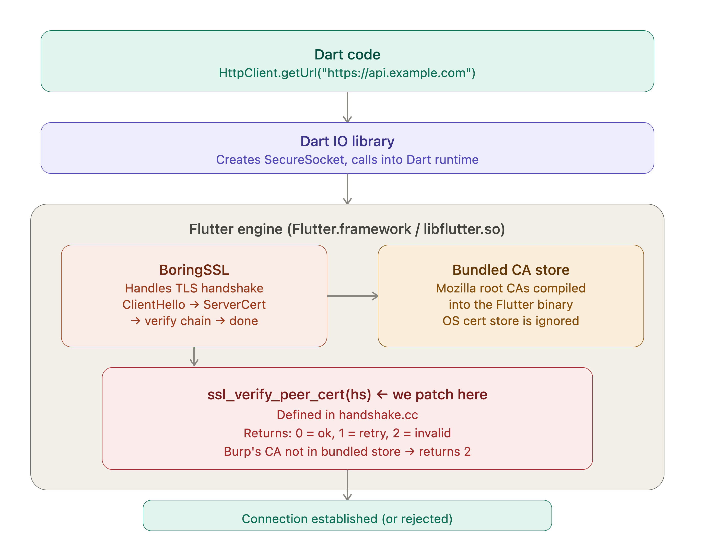
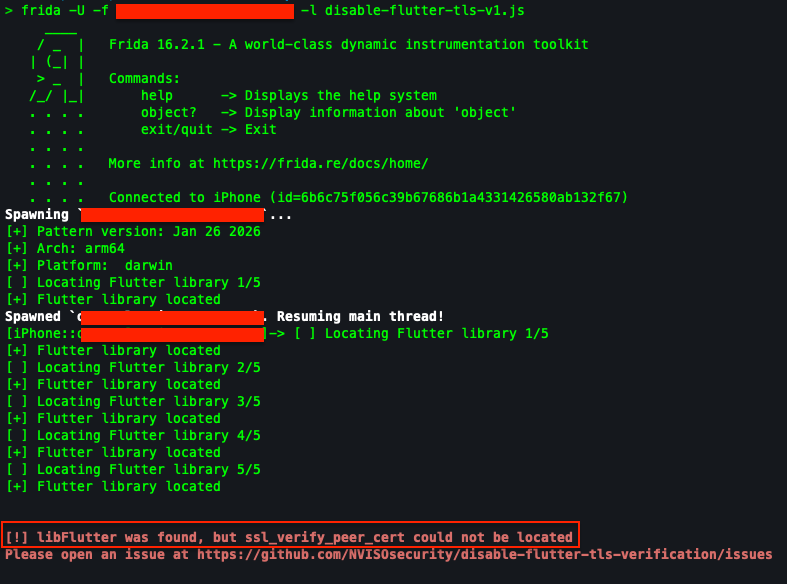
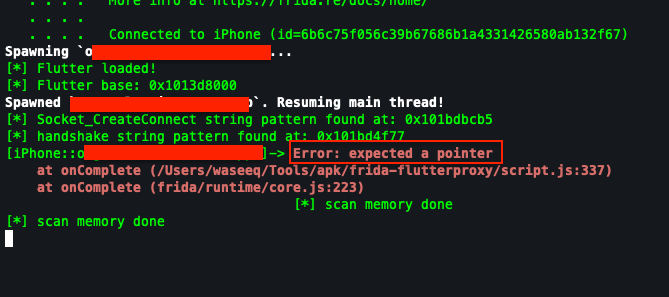
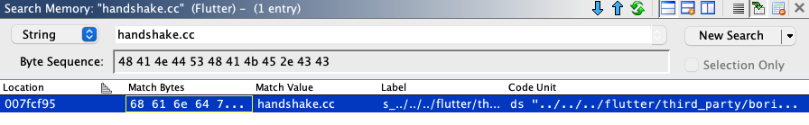
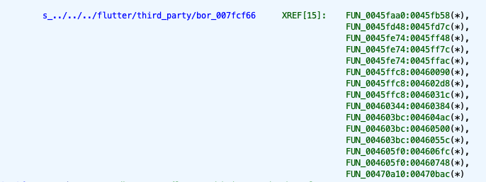
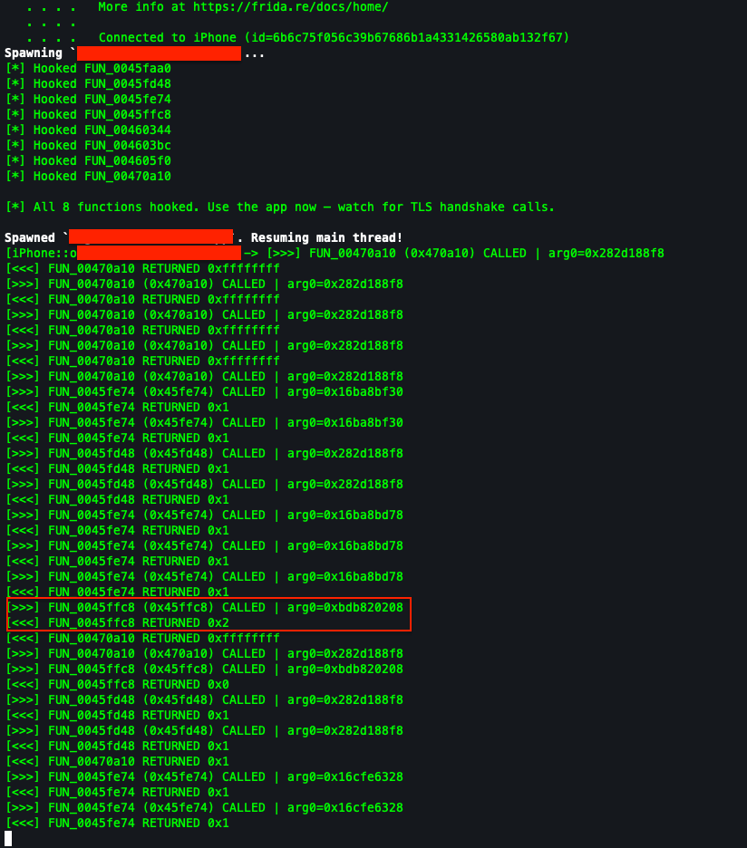
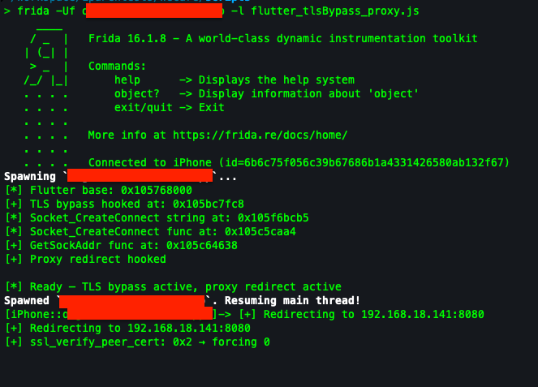

---

title: "Bypassing Flutter TLS on iOS Without Pattern Matching"
date: 2026-10-13
draft: false

categories: ["iOS"]
tags: ["flutter", "tls", "ios", "proxy"]

description: "When NVISO's script, reFlutter, and frida-flutterproxy all fail on a newer Flutter engine, here's how to find ssl_verify_peer_cert manually using Ghidra and build a combined TLS + proxy bypass in pure Frida."
showToc: true
---

## Introduction

If you've ever pentested a Flutter app on iOS, you know the pain. Flutter doesn't use the system proxy, doesn't trust the user installed certs, and bundles its own copy of BoringSSL with root CAs baked into the binary. Setting up Burp the usual way gets you nothing.

There are tools that handle this. NVISO's [disable-flutter-tls-verification](https://github.com/NVISOsecurity/disable-flutter-tls-verification) script, [reFlutter](https://github.com/Impact-I/reFlutter), and [frida-flutterproxy](https://github.com/hackcatml/frida-flutterproxy) all work great, until they don't. They rely on pattern matching specific byte sequences in the Flutter binary, and when the Flutter engine version is too new, the patterns go stale.
 
That's exactly what happened to me during a pentest of a Flutter app running **Dart 3.12** (engine commit `5d5317`). I tried all three. All three failed. So I found the function manually using Ghidra and wrote a combined bypass script that handles both TLS verification and proxy routing in pure Frida, no VPN, no iptables, no pfctl needed.

This post covers the full process. If you've been stuck on a newer Flutter build where the standard tools break, this approach will work regardless of the engine version.

---

## Why Flutter Traffic Is Hard to Intercept

Before getting into the bypass, it helps to understand what makes Flutter different from regular iOS apps. There are actually two separate problems, and you need to solve both.

### Problem 1: Dart ignores the system proxy

Regular iOS apps route HTTP traffic through the system proxy you configure in Wi-Fi settings. Flutter's Dart HTTP client doesn't. It opens raw sockets directly to the server, completely bypassing any proxy configuration. So even with Burp set up perfectly, Dart's traffic is invisible.

### Problem 2: Dart doesn't trust user-installed certificates

Even if you force the traffic through Burp (using a VPN, iptables, or some other redirect), Dart won't trust Burp's certificate. For regular iOS apps, installing Burp's CA and enabling full trust in Settings is enough. Flutter is different.

Flutter uses BoringSSL (Google's fork of OpenSSL) for TLS instead of the platform's native TLS library. It trusts the built-in iOS root CAs (Apple's pre-installed ones), but it does not properly pick up user-installed certificates, even with full trust enabled. This is a [known issue](https://github.com/flutter/flutter/issues/112830).

The certificate verification happens in a function called `ssl_verify_peer_cert`, defined in BoringSSL's `handshake.cc`. Patching this function bypasses all certificate validation regardless of where the CAs are loaded from. Burp's cert gets accepted, handshake completes, traffic flows.



So to intercept Flutter traffic on iOS, you need two things: a way to redirect Dart's sockets to Burp (proxy routing), and a way to make Dart accept Burp's certificate (TLS bypass).

---

## What I Tried (and Why It Failed)

### NVISO's disable-flutter-tls-verification

This is usually the go-to script. It finds the Flutter library in memory, then pattern matches the first ~30 bytes of `ssl_verify_peer_cert` to locate the function and patch it.

```bash
frida -U -f package_name -l disable-flutter-tls-v1.js
```

Output:

```
[+] Flutter library located
[!] libFlutter was found, but ssl_verify_peer_cert could not be located
```



It found the Flutter library but the byte pattern didn't match. The function compiles slightly differently in each Flutter engine version (different stack frame size, different register allocation, compiler optimizations), so the hardcoded patterns go stale on newer builds.

### reFlutter

reFlutter patches the Flutter framework binary statically and repackages the IPA. It maintains a database of pre-built patched binaries keyed by engine snapshot hash.

```bash
reflutter "test.ipa"
```

Output:

```
Engine SnapshotHash: 0451907c2eaa8467e848c0067bfe8ed4
This engine is currently not supported.
```

Our engine hash wasn't in their database. Dead end.

> **Update:** reFlutter has since added support for this engine hash. At the time of testing, it wasn't available.

### frida-flutterproxy

This one is interesting because it handles both TLS bypass AND proxy routing in one script. It parses the MachO binary, scans for BoringSSL strings, and hooks the socket layer.

First issue: it used `Module.getGlobalExportByName` which doesn't exist in my Frida version. Quick fix, changed it to `Module.findExportByName(null, name)`.

Second issue: the MachO parser had a variable shadowing bug that broke `__DATA.__const` section parsing. The ADRP+ADD pattern for `ssl_verify_peer_cert` also didn't match this Flutter version.

```
Error: expected a pointer
    at onComplete (flutterProxy.js:337)
```



Same root cause as the other tools: byte patterns that don't match the newer Flutter engine.

For context, on Android with the same Flutter version, NVISO's script found the function on the first try. The Android x86_64 binary happened to match one of their patterns. The iOS arm64 binary didn't. Same Flutter version, different compiled output.

---

## Understanding What We're Looking For

All three tools failed because they couldn't find `ssl_verify_peer_cert` by its byte pattern. But the function definitely exists in the binary. We know this because:

```bash
strings Flutter.framework/Flutter | grep "handshake.cc"
# Found at offset 0x7fcf95

strings Flutter.framework/Flutter | grep "CERTIFICATE_VERIFY_FAILED"
# Found at offset 0x776cef
```

Both strings are present. `ssl_verify_peer_cert` is defined in `handshake.cc` in BoringSSL's source, and it references these strings through error macros. The function is there, we just need a different way to find it.

The idea: instead of matching the function's byte pattern (which changes per build), find the **strings it references** (which don't change) and trace backwards to the function.

---

## Finding ssl_verify_peer_cert with Ghidra

I opened the Flutter framework binary in Ghidra:

```
Payload/Runner.app/Frameworks/Flutter.framework/Flutter
```

Auto-analysis would take some time to complete as it's a ~8.5MB binary, then I searched for the string `"handshake.cc"` 


Then I looked for functions referencing this string, I found 15 cross-references pointing to 8 unique functions:



```
FUN_0045faa0  (1 reference)
FUN_0045fd48  (1 reference)
FUN_0045fe74  (3 references)
FUN_0045ffc8  (3 references)
FUN_00460344  (1 reference)
FUN_004603bc  (3 references)
FUN_004605f0  (2 references)
FUN_00470a10  (1 reference)
```

`ssl_verify_peer_cert` is one of these 8. The `handshake.cc` file contains the entire TLS handshake flow, so multiple functions in it reference the filename string. I needed to figure out which one is specifically the certificate verification function.

---

## Identifying the Right Function

I could have tried to read the decompiled code for all 8, but there's a faster way. I wrote a Frida script that hooks all 8 functions and logs their return values at runtime:

```javascript
var flutter = Process.findModuleByName("Flutter");
var base = flutter.base;

var functions = [
    {name: "FUN_0045faa0", offset: 0x0045faa0},
    {name: "FUN_0045fd48", offset: 0x0045fd48},
    {name: "FUN_0045fe74", offset: 0x0045fe74},
    {name: "FUN_0045ffc8", offset: 0x0045ffc8},
    {name: "FUN_00460344", offset: 0x00460344},
    {name: "FUN_004603bc", offset: 0x004603bc},
    {name: "FUN_004605f0", offset: 0x004605f0},
    {name: "FUN_00470a10", offset: 0x00470a10},
];

functions.forEach(function(f) {
    Interceptor.attach(base.add(f.offset), {
        onEnter: function(args) {
            console.log("[>>>] " + f.name + " CALLED");
        },
        onLeave: function(retval) {
            console.log("[<<<] " + f.name + " RETURNED " + retval);
        }
    });
});
```

Then launched the app with Burp's proxy configured so the TLS handshake would fail:

```bash
frida -U -f package_name -l identify_ssl_from_ghidra.js
```

The output made it obvious:



```
[>>>] FUN_0045ffc8 CALLED
[<<<] FUN_0045ffc8 RETURNED 0x2
[>>>] FUN_0045ffc8 CALLED
[<<<] FUN_0045ffc8 RETURNED 0x0
```

**`FUN_0045ffc8`** returned `0x2`. In BoringSSL's `ssl_verify_result_t` enum:

- `0` = `ssl_verify_ok` (certificate valid)
- `1` = `ssl_verify_retry` (try again)
- `2` = `ssl_verify_invalid` (certificate rejected)

That's the function rejecting Burp's certificate. The `0x0` return on the second call was probably Sentry's traffic hitting a legitimate server.

The other functions returned `0x1` (retry, part of the handshake state machine) or `0xffffffff` (handshake driver), confirming they're different parts of the handshake flow, not the cert verification.

---

## Patching It

With the offset confirmed, the TLS bypass is straightforward:

```javascript
var flutter = Process.findModuleByName("Flutter");
var ssl_verify_peer_cert = flutter.base.add(0x0045ffc8);

Interceptor.attach(ssl_verify_peer_cert, {
    onLeave: function(retval) {
        if (retval.toInt32() !== 0) {
            console.log("[+] ssl_verify_peer_cert: " + retval + " → forcing 0");
            retval.replace(0);
        }
    }
});
```

Every time the function returns anything other than `0`, we force it to `0`. BoringSSL now tells the Dart runtime "certificate is fine" and the TLS handshake completes.

At this point, Dart accepts Burp's certificate. But the traffic still wasn't showing up in Burp because of the proxy routing problem.

---

## Solving the Proxy Routing Problem

TLS bypass alone isn't enough. Dart opens direct sockets to the server, completely ignoring the iOS system proxy. On Android I used iptables to redirect traffic at the kernel level. On this jailbroken iPhone:

- `pfctl` wasn't available on this jailbreak
- No Shadowrocket or VPN apps installed
- `/etc/hosts` redirect would work but only for one domain at a time

I needed something that runs entirely in Frida, no external tools.

### The GetSockAddr technique

The idea comes from `frida-flutterproxy`. When Dart creates a socket connection, it goes through these steps inside the Flutter binary:

1. `Socket_CreateConnect` is called to create the connection
2. Inside it, `GetSockAddr` is called to build the `sockaddr` struct (destination IP + port)
3. The socket connects to that address

If we hook `GetSockAddr` and overwrite the `sockaddr` with Burp's IP and port, Dart connects to Burp instead of the real server. Burp then forwards to the real server using its own connection.

### Finding the functions

First, find the `"Socket_CreateConnect"` string in the Flutter binary:

```javascript
var flutter = Process.findModuleByName("Flutter");
var socketStr = "53 6f 63 6b 65 74 5f 43 72 65 61 74 65 43 6f 6e 6e 65 63 74 00";

flutter.enumerateRanges('r--').forEach(function(range) {
    var matches = Memory.scanSync(range.base, range.size, socketStr);
    if (matches.length > 0) {
        console.log("[*] Socket_CreateConnect string at: " + matches[0].address);
    }
});
```

Then scan memory for a pointer to that string (it's in a dispatch table), walk backwards to find the function address, and disassemble it to find the 2nd `BL` (branch-link) instruction, which is the call to `GetSockAddr`:

```javascript
// Find function via dispatch table pointer
var funcAddr = pointerMatch.address.sub(0x10).readPointer();

// Disassemble to find GetSockAddr (2nd BL instruction)
var blCount = 0;
for (var off = 0; off < 200; off += 4) {
    var instr = Instruction.parse(funcAddr.add(off));
    if (instr.mnemonic === "bl") {
        blCount++;
        if (blCount === 2) {
            getSockAddrFunc = ptr(instr.operands[0].value);
            break;
        }
    }
}
```

### Hooking GetSockAddr

Once we have the `GetSockAddr` function, we hook it to capture the `sockaddr` pointer, then hook `socket()` to overwrite the destination:

```javascript
var BURP_IP = "192.168.18.141";
var BURP_PORT = 8080;

Interceptor.attach(getSockAddrFunc, {
    onEnter: function(args) {
        currentSockAddr = args[1];
    }
});

Interceptor.attach(Module.findExportByName(null, "socket"), {
    onEnter: function(args) {
        if (currentSockAddr !== null) {
            var family = ptr(currentSockAddr).add(0x1).readU8();
            if (family === 2) {  // AF_INET
                // Overwrite port
                ptr(currentSockAddr).add(0x2).writeU16(byteFlip(BURP_PORT));
                // Overwrite IP
                ptr(currentSockAddr).add(0x4).writeByteArray(
                    BURP_IP.split('.').map(function(o) { return parseInt(o); })
                );
            }
        }
    }
});
```

Note the iOS sockaddr quirk: `sa_family` is at offset `+1` (not `+0` like Linux), because iOS has a `sa_len` field at `+0`.

---

## The Final Script

I combined everything into one script. The TLS bypass uses the hardcoded offset from Ghidra, and the proxy redirect discovers `GetSockAddr` at runtime:

```bash
frida -U -f package_name -l flutter-ios-tls-proxy-bypass.js
```

Output:

```
[+] TLS bypass hooked at: 0x10581bfc8
[*] Socket_CreateConnect string at: 0x10601fcb5
[*] Socket_CreateConnect func at: 0x105c2a100
[+] GetSockAddr func at: 0x105c29f80
[+] Proxy redirect hooked
[+] ssl_verify_peer_cert: 0x2 → forcing 0
[+] Redirecting to 192.168.18.141:8080
```



Make sure Burp has **invisible proxying** enabled on the listener (Settings → Proxy listeners → Edit → Request handling → Support invisible proxying). This is needed because the redirected traffic doesn't have a CONNECT header, Burp figures out the destination from the TLS SNI header instead.

---

## Adapting for Your Target

The Ghidra approach works on any Flutter version. Here's the process:

**1. Find the Flutter binary:**
```
# iOS
Payload/Runner.app/Frameworks/Flutter.framework/Flutter

# Android
lib/arm64-v8a/libflutter.so
```

**2. Open in Ghidra, search for `"handshake.cc"`:**

Search → For Strings → `handshake.cc` → double-click → References → Find References to.

You'll get a list of functions (8 in my case, could be more or fewer depending on the version).

**3. Hook all candidates with Frida:**

Take every unique function from the xref list, hook them all, log return values. The one that returns `0x2` when Burp is proxying is `ssl_verify_peer_cert`.

**4. Patch it:**

```javascript
var flutter = Process.findModuleByName("Flutter");
Interceptor.attach(flutter.base.add(YOUR_OFFSET), {
    onLeave: function(retval) {
        if (retval.toInt32() !== 0) retval.replace(0);
    }
});
```

**5. Add proxy redirect if needed:**

If you don't have a VPN or iptables available, search for `"Socket_CreateConnect"` in the Flutter binary, find `GetSockAddr` via the 2nd `BL` instruction, and hook the sockaddr. The discovery code in the final script handles this automatically.

**Why this works on any version:** We never search for the function's byte pattern (which changes per build). We search for the `"handshake.cc"` string (which comes from BoringSSL's source and is always present), then identify the function by its runtime behavior. The string reference and the return value semantics are stable across versions.

---

## Takeaways

- **Pattern matching is fragile.** Every tool that failed was doing the same thing: searching for a fixed byte sequence that changes with each compiler output. If you're building a tool, consider string-based function discovery instead.
- **Ghidra xrefs + Frida identification is version-independent.** The `"handshake.cc"` string and the BoringSSL return values (`0` / `1` / `2`) are stable across Flutter versions. This approach doesn't go stale.
- **Proxy routing and TLS bypass are separate problems.** Solving one doesn't solve the other. You need both for full interception.
- **iOS sockaddr is different.** `sa_family` is at offset `+1` because of the `sa_len` field at `+0`. Easy to miss if you're used to Linux.

---

## Scripts

- [Flutter iOS TLS Proxy Bypass](https://codeshare.frida.re/@waseeq14/flutter-ios-tls-proxy-bypass/) — combined TLS bypass + proxy redirect (the final working script)
- [Flutter TLS Identify](https://codeshare.frida.re/@waseeq14/flutter-tls-identify/) — hooks all Ghidra xref candidates to identify `ssl_verify_peer_cert`

---
