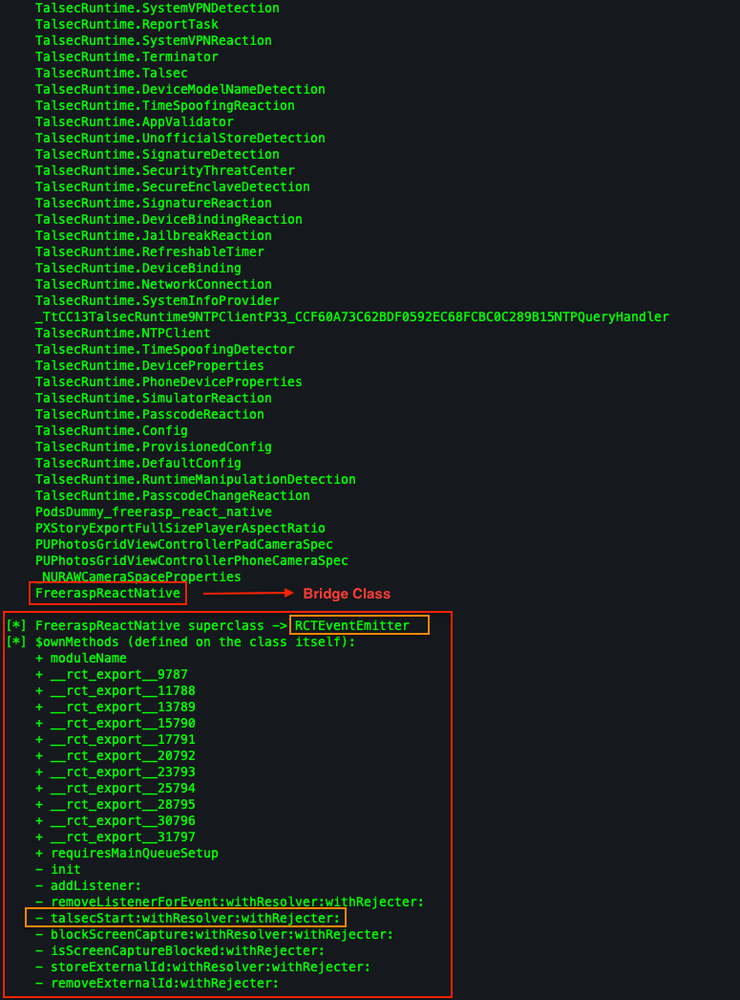
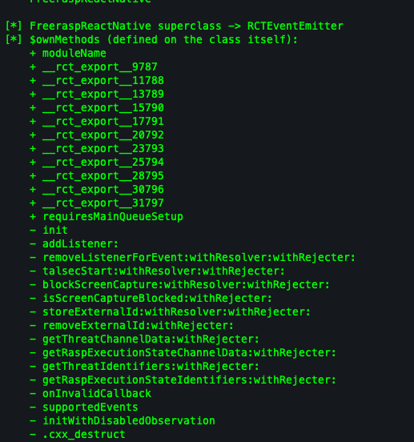
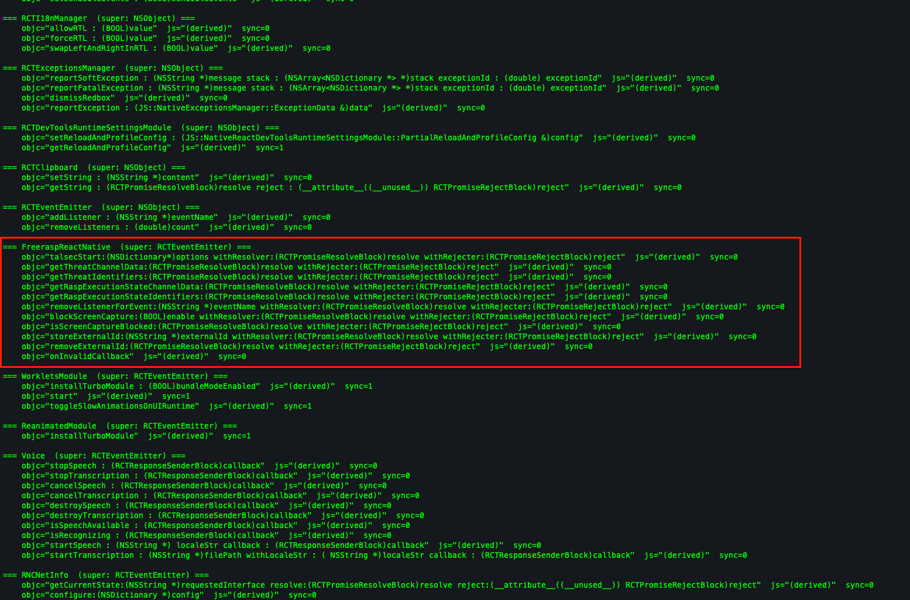
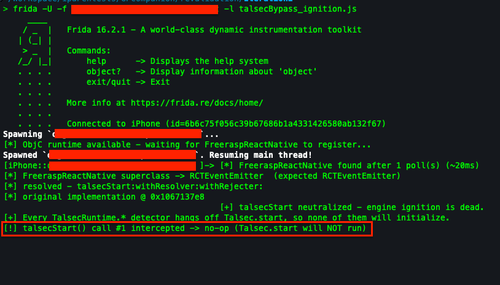
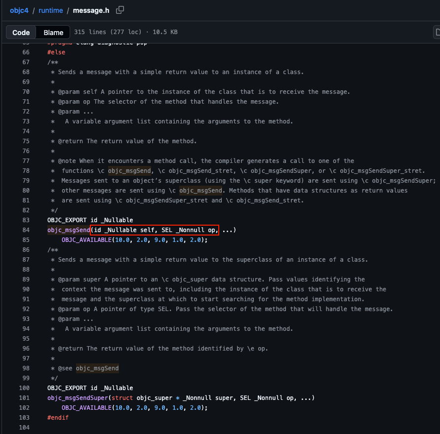
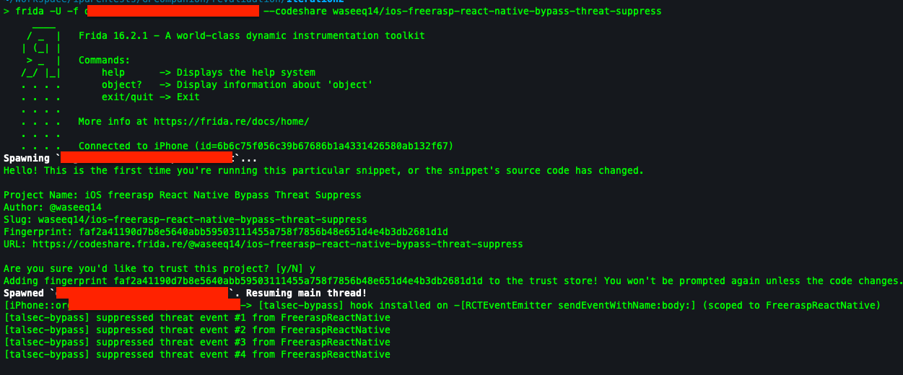

<!--
  SCREENSHOTS TO CAPTURE (from the demo app, not a client build):
    scan-classes.png     - the class-scan output (FreeraspReactNative + TalsecRuntime.* cluster)
    ownmethods.png       - $ownMethods dump of FreeraspReactNative
    export-table.png     - decoded __rct_export__ selector table
    noop-console.png     - talsecStart no-op bypass, console output
    suppress-console.png - sendEventWithName:body: suppression, console output
  Drop them in THIS folder and swap the filenames below. Numbered names are fine too.

  TODO before publish: upload the two enum scripts to codeshare and fix the @waseeq14/... slugs.
-->

## Introduction

About a year ago I was pentesting an IPA, and it shipped with Talsec freeRASP. So I did what most people do - searched for a bypass, found a script, ran it, moved on. This one:

```javascript
Interceptor.replace(
    ObjC.classes.FreeraspReactNative['- talsecStart:withResolver:withRejecter:'].implementation,
    new NativeCallback(function () {}, 'void', [])
);
```

Spawn the app, run it, freeRASP goes quiet. Job done.

I’d already spent a good while learning React Native internals, on both Android and iOS. But I never actually bothered to understand why this script works. It worked, I had a report to write, and that was that.

Then one day it just stopped working lol. I still don’t know what the issue was, the next time I tried the exact same script it worked again, so maybe it was a timing thing, maybe something on my setup. But for that one day it was dead, and that turned out to be a blessing in disguise. It annoyed me enough to finally sit down and figure out what this one-liner is actually doing - how freeRASP’s native module registers with React Native, how someone found talsecStart in the first place, why the selector has that weird withResolver:withRejecter: tail. And once I understood it properly, I realised there’s a second, completely different way to get the same result - attacking a different part of the plugin entirely.

So that’s what this post is. It’s the internals: how an RN native module is wired up on iOS, how you’d find the start method yourself on an app where the class isn’t conveniently named FreeraspReactNative, and the two separate places you can hit freeRASP once you understand how it’s put together. If you want to actually learn how RN works under the hood and walk away able to bypass freeRASP two different ways instead of pasting one magic line, this is for you.

This one’s iOS-only. Android will get its own follow-up soon. All the Frida Codeshare links are mentioned at the end.

---

## What freeRASP actually is

[freeRASP](https://github.com/talsec/Free-RASP-ReactNative) is Talsec's RASP - Runtime Application Self-Protection. It's a security library you drop into your app that watches, at runtime, for the stuff that means someone's poking at it: jailbreak, a debugger attached, Frida/hooking, tampering, a resigned binary, running in a simulator, and so on. When it spots something, it fires a callback and your app decides what to do - log the user out, wipe a token, show a block screen, exit.

The one fact to hold onto before anything else: **freeRASP for React Native is a thin, open-source bridge sitting on top of a closed-source native engine.** The RN plugin (the part you can read on GitHub) is just glue. The actual detection logic lives in a precompiled binary, `TalsecRuntime.xcframework`, that ships with the plugin. Everything in this post comes back to that split - the glue is where you attack, the engine is what you're trying to keep from ever waking up.

---

## The internals

### Two tiers: a bridge and an engine

Before writing any hook, just dumping the Objective-C classes in the running app tells the whole story.

The quickest way to do that is a name-pattern sweep over the ObjC runtime - I've put it on Frida CodeShare as [objc-runtime-class-scanner](https://codeshare.frida.re/@waseeq14/objc-runtime-class-scanner/). It's dead simple: it walks `ObjC.classes`, and for every class whose name matches a pattern (`/rasp|talsec|freerasp/i` here) it prints the class, its superclass, and its `$ownMethods` - the methods defined on the class itself, with everything inherited stripped out. We only inspect one class in detail, `FreeraspReactNative`, because (as you'll see) it's the only one of these we can actually reach from JS.



Two groups jump out of the scan. There's exactly **one** React Native bridge class, `FreeraspReactNative`, plus a few helper classes in the `freerasp_react_native` namespace (`ThreatDispatcher`, `RandomGenerator`, `ExecutionStateDispatcher`). And then there's a whole wall of `TalsecRuntime.*` classes - `DebuggerDetection`, `TamperingDetection`, `SignatureDetection`, `SimulatorDetection`, `RuntimeManipulationDetection`, `JailbreakReaction`, `SecurityThreatCenter`, `Terminator`, and `Talsec` itself.

Notice the design in that wall: almost every threat comes as a **Detection/Reaction pair** - `DebuggerDetection`/`DebuggerReaction`, `SignatureDetection`/`SignatureReaction`, `SimulatorDetection`/`SimulatorReaction` etc. That's the closed engine, compiled into `TalsecRuntime.xcframework`. `FreeraspReactNative` is the open-source glue that wires it to your JavaScript. Dozens of detectors, one bridge class sitting on top of them and only that bridge class is reachable from JS. So you must have an idea in your mind right now, all it takes to null all the detectors is to hook the ONLY bridge class. But what to do after hooking the class?

That one detailed dump is the map for the rest of this post. The superclass line already tells us something: `FreeraspReactNative` inherits from `RCTEventEmitter`, which means it can push events *up* to JS on its own. And its `$ownMethods` list has three things we'll pull apart in the next sections: the real selectors (`talsecStart:...`, the one we're hunting), the self-defense methods (`getThreatIdentifiers:`, `onInvalidCallback`), and that cluster of `+ __rct_export__NNNN` entries. Those last ones are the key to how RN actually finds and calls `talsecStart`, so that's where we start. Dont worry, I will be explaining everything in detail.

### How a React Native native module registers

To find the start method, you need to know how RN exposes native code to JS in the first place. [freeRASP](https://github.com/talsec/Free-RASP-ReactNative/blob/master/ios)'s module is open source, so we can look at the exact wiring. There are two files, and they have to agree with each other.

The Swift side (`ios/FreeraspReactNative.swift`) declares the class and the method:

```swift
@objc(FreeraspReactNative)
class FreeraspReactNative: RCTEventEmitter {
    @objc(talsecStart:withResolver:withRejecter:)
    func talsecStart(options: NSDictionary, resolve: RCTPromiseResolveBlock, rejecter reject: RCTPromiseRejectBlock) -> Void {
        do { try initializeTalsec(talsecConfig: options) }
        catch let error as NSError {
            reject("TalsecInitializationError", "Could not initialize freeRASP: \(error.domain)", error)
            return
        }
        resolve("freeRASP started")
    }

    func initializeTalsec(talsecConfig: NSDictionary) throws {
        // ... pulls appBundleId / appTeamId / watcherMail / isProd out of the config ...
        let config = TalsecConfig(appBundleIds: [appBundleIds], appTeamId: appTeamId, watcherMailAddress: watcherMailAddress, isProd: isProd)
        Talsec.start(config: config)
    }
}
```

And an Objective-C bridging file (`ios/FreeraspReactNative.m`) that re-declares the same thing for the bridge:

```objc
@interface RCT_EXTERN_MODULE(FreeraspReactNative, RCTEventEmitter)

RCT_EXTERN_METHOD(talsecStart:(NSDictionary*)options
                  withResolver:(RCTPromiseResolveBlock)resolve
                  withRejecter:(RCTPromiseRejectBlock)reject)
// ... ten more RCT_EXTERN_METHOD declarations ...
@end
```

A few things worth pulling out of this, because they answer the "how did they know the selector" question completely:

**The selector name is declared, not discovered.** Look at the Swift function. Its actual Swift name is `talsecStart(options:resolve:rejecter:)`. But the thing Frida hooks is `talsecStart:withResolver:withRejecter:`, a different string. The `@objc(...)` attribute is what renames the Swift method into that exact Objective-C selector, and it has to match the `RCT_EXTERN_METHOD` line in the `.m` byte-for-byte or the bridge can't wire JS to native.

**`talsecStart` barely does anything.** It calls `initializeTalsec`, which calls `Talsec.start(config:)`. And `Talsec.start` lives in the closed `TalsecRuntime` binary - that's the real ignition. Everything in that wall of `*Detection` classes gets spun up downstream of this one call. Which is the whole reason the bypass is a one-liner: no-op `talsecStart`, `Talsec.start` never runs, the engine never initializes, and every detector is stillborn.

**The class is an `RCTEventEmitter`.** Not a plain `NSObject`. That matters - it means the module can push events *up* to JS on its own, which is exactly how a detected threat becomes a callback in your app. Hold that thought, it's the second attack surface. 

### The two registration layers

There are actually **two** separate registration mechanisms in play, and they're independent.

Dump the methods defined directly on the class (`$ownMethods`, which skips everything inherited):



You get the real selectors - `talsecStart:withResolver:withRejecter:`, `blockScreenCapture:...`, `getThreatIdentifiers:...` and friends, but also a cluster of oddly-named class methods: `+ moduleName`, `+ requiresMainQueueSetup`, and a bunch of `+ __rct_export__9787`, `+ __rct_export__11788`, and so on.

Those two things are the two layers:

- **The Objective-C method list.** The `@objc(...)` selector becomes a genuine method in the class's method table at compile time. This is what `$ownMethods` reads, and it's the layer `Interceptor.replace` operates on. It exists whether or not React Native is anywhere nearby.
- **The React Native bridge metadata.** Each `RCT_EXTERN_METHOD` in the `.m` makes the macro synthesize one `__rct_export__NNNN` class method. RN scans all of these at startup to build its JS-to-native routing table. Count them, there are eleven `__rct_export__` methods, and eleven `RCT_EXTERN_METHOD` lines in the `.m`.

Each `__rct_export__` method just returns a little static struct describing one exported method. The struct, straight from the [RN headers](https://github.com/facebook/react-native/blob/main/packages/react-native/React/Base/RCTBridgeModule.h):

```c
typedef struct RCTMethodInfo {
  const char *const jsName;
  const char *const objcName;   // <- the ObjC selector string, verbatim
  const BOOL isSync;
} RCTMethodInfo;
```

Which means you can decode RN's own routing table straight out of memory, a second, totally independent way to recover `talsecStart:withResolver:withRejecter:` that doesn't even look at the method list. More on that in recon.

So when your JS calls `talsecStart(config)`:

1. The bridge looks up the method in **layer 2** (the `__rct_export__` metadata) to find the selector.
2. It appends the `resolve` and `reject` promise blocks to the arguments (this is why JS passes one arg but the selector takes three, more on that later too).
3. It invokes the selector on the module instance via **layer 1** (the method list).

The bypass only has to poison layer 1. Swap the implementation in the method list, and the bridge happily routes the JS call straight into your no-op without ever knowing anything changed. You're intercepting *below* the point where the bridge makes its decision. That's why one `Interceptor.replace` is enough. 

### Module name vs method name

There's one little concept I wanted to clear also. The JS call is `NativeModules.FreeraspReactNative.talsecStart(config)`, and those two names come from two different places:

- `+ moduleName` (a class method) returns the name the **module** is registered under - that's the `FreeraspReactNative` in `NativeModules.FreeraspReactNative`.
- The `objcName` in each `__rct_export__` entry gives the **method**. And here's a fun detail: for `RCT_EXTERN_METHOD` the `jsName` field is left empty, so RN *derives* the JS method name by taking everything up to the first colon of the selector. `talsecStart:withResolver:withRejecter:` → JS `talsecStart`. That derivation is exactly why JS imports `talsecStart` but the selector carries the `withResolver:withRejecter:` baggage.

### The two channels

As per the formal definition, `RCTEventEmitter` is an abstract base class in React Native used by native modules (primarily on iOS/Objective-C/Swift) to dispatch asynchronous events from native code to JavaScript

Because the module is an `RCTEventEmitter`, communication runs **both** directions, and each direction is a separate thing you can attack:

- **Down (ignition):** JS → `talsecStart:withResolver:withRejecter:` → `Talsec.start`. This is the switch that turns the engine on.
- **Up (reporting):** engine detects a threat → `SecurityThreatCenter` → `ThreatDispatcher` → the inherited `-[RCTEventEmitter sendEventWithName:body:]` → your JS threat callback fires.

Keep this frame. Every bypass below is just picking one of these two channels.

Until now, I suppose you have an understanding of the full strucuture. Let's move forward.

---

## Recon: finding the module without being told its name

### The naive way, and why it's fragile

Consider this snippet from the script we used earlier:

```javascript
for (const name in ObjC.classes) {
    if (/rasp|talsec|freerasp/i.test(name)) console.log(name);
}
```

This works here *only because freeRASP is open source and ships readable Swift symbols.* Point it at a commercial RASP (Appdome, Promon, Guardsquare, Build38) that strips or randomizes its class names and the regex returns nothing. So the name grep is the least reusable part of the whole thing. We want something that doesn't depend on the name at all.

### A better, name-independent enumerator

Every legacy-style RN native module synthesizes those `__rct_export__` methods regardless of what it's called. So instead of guessing names, scan for the marker, then read off each module's exported selectors by decoding the `RCTMethodInfo` struct we saw earlier.

<details>
<summary>ios-rn-export-dumper.js - click to expand</summary>

```javascript
/*
 * ios-rn-export-dumper
 * --------------------
 * Dumps the exported method table of React Native native modules on iOS by
 * decoding the __rct_export__ metadata the RCT_EXPORT/RCT_EXTERN macros
 * synthesize. For each module it prints the real ObjC selector (objcName),
 * the JS-facing name, and the isSync flag - recovering the JS->native routing
 * table straight from memory, source or no source.
 *
 * Scope: finds legacy-style RN modules (RCT_EXPORT/RCT_EXTERN), including when
 * they run under New Architecture via the interop layer. Does NOT find genuine
 * codegen TurboModules (JSI-dispatched, often no ObjC class). The litmus test
 * is the module itself, not the app's architecture.
 *
 * Author: Waseeq Ur Rehman
 */

if (!ObjC.available) throw new Error("[-] ObjC runtime unavailable");
const PS = Process.pointerSize;

for (const name in ObjC.classes) {
    let cls, own;
    try { cls = ObjC.classes[name]; own = cls.$ownMethods; } catch (e) { continue; }

    const exports = own.filter(m => m.indexOf('__rct_export__') !== -1);
    if (exports.length === 0) continue;

    const sup = cls.$superClass ? cls.$superClass.$className : '?';
    console.log(`\n=== ${name}  (super: ${sup}) ===`);
    exports.forEach(sel => {
        try {
            const fn   = new NativeFunction(cls[sel].implementation, 'pointer', ['pointer', 'pointer']);
            const info = fn(cls.handle, ObjC.selector(sel.substring(2)));
            const jsName   = info.readPointer().readUtf8String();
            const objcName = info.add(PS).readPointer().readUtf8String();
            const isSync   = info.add(PS * 2).readU8();
            console.log(`    objc="${objcName}"  js="${jsName || '(derived)'}"  sync=${isSync}`);
        } catch (e) {
            console.log(`    <${sel}: ${e.message}>`);
        }
    });
}
```

</details>

Running it against the demo app prints every bridge module and its real selectors, and freeRASP's shows up with the `jsName` fields empty (derived) and `talsecStart` sitting right there:



That's the recon that actually generalizes. You look for the verb in the selector list - `start`, `initialize`, `setup`, `configure` - and you've found ignition without ever caring what the class is named.

If you want an even broader net that also catches modules exporting *zero* methods (a pure event emitter has no `__rct_export__` to match), key on `+ moduleName` instead - it's present on every legacy module whether or not it exports anything:

<details>
<summary>ios-rn-module-inventory.js - click to expand</summary>

```javascript
/*
 * ios-rn-module-inventory
 * -----------------------
 * Lists every legacy / interop React Native native module in an iOS app by
 * scanning the ObjC runtime for classes that respond to +moduleName. Prints
 * each module's class name and superclass. Name-independent: +moduleName is
 * emitted by the RN registration macros regardless of the class name, so it
 * survives class-name obfuscation.
 *
 * Does NOT find true codegen TurboModules. Pairs with ios-rn-export-dumper.
 *
 * Author: Waseeq Ur Rehman
 */

if (!ObjC.available) throw new Error("[-] ObjC runtime unavailable");

console.log("[*] React Native native modules (legacy / interop):");
for (const name in ObjC.classes) {
    let cls;
    try { cls = ObjC.classes[name]; } catch (e) { continue; }
    try {
        if (cls.$ownMethods.indexOf('+ moduleName') !== -1) {
            const sup = cls.$superClass ? cls.$superClass.$className : '?';
            console.log(`    ${name}  (super: ${sup})`);
        }
    } catch (e) {}
}
```

</details>

In practice I run both: the inventory to see every module, then the dumper on whichever one looks like the RASP to read its selectors.

<!-- Both scripts are on Frida CodeShare:
- https://codeshare.frida.re/@waseeq14/ios-rn-native-module-inventory/
- https://codeshare.frida.re/@waseeq14/ios-rn-export-dumper/
-->
---

## The one idea the whole bypass rests on

Before the scripts, the single sentence to take away: **dozens of detectors, one ignition switch.**

Every `*Detection` class in that `TalsecRuntime` wall is constructed downstream of `Talsec.start`, which is reached only through `talsecStart`. So you have a choice of where to stand:

- Stand at the **switch** (`talsecStart`) and nothing ever turns on. One hook, total coverage.
- Stand at the **reporting pipe** (`sendEventWithName:body:`) and let everything run, but intercept the news on its way out.

---

## Attack 1 - the down channel (ignition)

### The no-op

This is the canonical one-liner. Replace `talsecStart` with a function that does nothing. This script is already available on Frida Codeshare by `@rodolfomarianocy` here: `https://codeshare.frida.re/@rodolfomarianocy/ios-freerasp-react-native-bypass/` . I used the same script, just added a little verbosity to it.

```javascript
if (ObjC.available) {
    Interceptor.replace(
        ObjC.classes.FreeraspReactNative['- talsecStart:withResolver:withRejecter:'].implementation,
        new NativeCallback(function () {}, 'void', [])
    );
    console.log("[+] talsecStart neutralized - engine never starts");
}
```



`Talsec.start` never runs, so nothing in the engine initializes, so nothing ever detects anything. Clean. But two things about this deserve an actual explanation, because they're the parts that look wrong until you get them.

### Why zero args doesn't crash

The selector takes three arguments - `options`, `resolve`, `reject`, but the `NativeCallback` is declared `'void', []`, i.e. *no* arguments. How does that not blow up?

First, every Objective-C method secretly takes two more args before the ones you see. The real C-level signature is always:

```c
ReturnType method(id self, SEL _cmd, /* your declared args */);
```

You can refer to `https://github.com/apple-oss-distributions/objc4/blob/objc4-906/runtime/message.h` to better understand.


So `talsecStart:withResolver:withRejecter:` is really a 5-argument function down at the metal: `(self, _cmd, options, resolve, reject)`.

Second - and this is the actual reason - on **arm64** (every iOS device and Apple-silicon sim) the first eight pointer-ish arguments are passed in registers `x0`–`x7`, and it's the *caller's* job to set them up, not the callee's to consume them. When RN invokes the method, it's already loaded:

```
x0 = self      x1 = _cmd      x2 = options      x3 = resolve      x4 = reject
```

If you are still having trouble to understand, then in simple words: when you replace an implementation, you become the *callee*, not the caller. React Native is the caller. By the time your no-op runs, RN has already done all the work of making the call, it loaded `self`, `_cmd`, `options`, `resolve`, and `reject` into `x0`-`x4` and jumped to the method. Those five values are already sitting in the registers.

A callee never sends its own arguments, it receives them. So your no-op has nothing to send and nothing to set up. The args are already there; it just doesn't look at them. It reads nothing, returns nothing, and hands control back. Nothing on the stack got touched, nothing got left half-done (on arm64, cleaning up after a call is the caller's job, not the callee's), so the process carries on like normal.

It would only bite you if you tried to *use* an argument (then you'd have to declare enough of the list for Frida to hand you the right register), or if the return type mattered and you got it wrong (here it's `void`, so returning void is correct). But REMEMBER THIS: this tolerance is an `arm64` property. Don't carry "args don't need to match" over to a stack-heavy convention like 32-bit x86 :p On iOS you're always arm64, so in practice it's a non-issue.

There's also a side effect worth clocking: by returning immediately, the no-op never calls `resolve` *or* `reject`. So the JS promise from `talsecStart()` never settles, it just hangs forever, but suppose on an app whose JS actually `await`s start, a dangling promise could stall init. Which leads to the cleaner version.

### resolve the promise properly

Same kill (engine still never starts), but tidy up after yourself by resolving the promise the way the real method would:

```javascript
Interceptor.replace(
    ObjC.classes.FreeraspReactNative['- talsecStart:withResolver:withRejecter:'].implementation,
    new NativeCallback(function (self, _cmd, options, resolve, reject) {
        // resolve is an RCTPromiseResolveBlock - an ObjC block, not a C function pointer.
        const resolveBlock = new ObjC.Block(resolve);
        resolveBlock.implementation("freeRASP started");   // mimic the real success path
    }, 'void', ['pointer', 'pointer', 'pointer', 'pointer', 'pointer'])
);
```

Now all five args are declared, so Frida hands you `resolve` in the right register, and you call it exactly like the source does (`resolve("freeRASP started")`). JS sees a normal success instead of a hung promise. The one gotcha: `resolve` arrives as a **block**, which has its own ABI, so you wrap it with `new ObjC.Block(resolve)`, trying to `NativeFunction` it directly will misbehave.

The concepts we discussed above were not that necassary for the bypass, but it's still some good knowledge I wanted to share.

Remember `RuntimeManipulationDetection` in the class list - that's freeRASP's anti-Frida check. If the engine starts before your hook is in place, that check can run and clock you. So you **spawn** the app (-f in frida) and install the replace before the JS ever calls `talsecStart`.

---

## Attack 2 - the up channel (reporting)

The other option: let the engine run and lie on the way out. Instead of killing ignition, intercept the reporting pipe and swallow threat events so the JS-side reaction never fires.

`FreeraspReactNative` doesn't implement its own event sender, it inherits `sendEventWithName:body:` from `RCTEventEmitter` and calls it to report threats. So you replace that one inherited implementation, but **only** swallow the call when the caller is freeRASP, because that same method is shared by half of RN's core modules (`RCTNetworking`, keyboard observers, etc.) and nuking all of it would brick the app. This is what I implemented after the firt approach stopped working for a day, God knows why.

<details>
<summary>ios-freerasp-react-native-bypass-threat-suppress - click to expand</summary>

```javascript
if (!ObjC.available) {
    console.log("[!] Objective-C runtime not available");
} else {
    var waitTries = 0;
    var waitIv = setInterval(function () {
        waitTries++;
        if (ObjC.classes.FreeraspReactNative && ObjC.classes.RCTEventEmitter) {
            clearInterval(waitIv);
            installHook();
        } else if (waitTries > 100) {
            clearInterval(waitIv);
            console.log("[!] gave up waiting for FreeraspReactNative / RCTEventEmitter to load");
        }
    }, 50);
}

function installHook() {
    var method = ObjC.classes.RCTEventEmitter['- sendEventWithName:body:'];
    var origImpl = method.implementation;
    var orig = new NativeFunction(origImpl, 'void', ['pointer', 'pointer', 'pointer', 'pointer']);

    var suppressed = 0;

    Interceptor.replace(origImpl, new NativeCallback(function (self, cmd, name, body) {
        var obj = new ObjC.Object(self);
        if (obj.$className === 'FreeraspReactNative') {
            suppressed++;
            console.log('[talsec-bypass] suppressed threat event #' + suppressed + ' from FreeraspReactNative');
            return; // swallow: never reaches JS
        }
        orig(self, cmd, name, body);
    }, 'void', ['pointer', 'pointer', 'pointer', 'pointer']));

    console.log('[talsec-bypass] hook installed on -[RCTEventEmitter sendEventWithName:body:] (scoped to FreeraspReactNative)');
}
```

</details>



Two mechanics worth calling out here, since they're the opposite of the no-op's:

**You declare all the args this time**, because you actually need them. Two colons in `sendEventWithName:body:` = two real args (`name`, `body`), plus the two hidden ones = four pointers. You read `self` to decide whether it's freeRASP, and you pass `name`/`body` straight through for everyone else.

**The call-through pattern.** You grab `impl` and wrap it as `orig` *before* calling `Interceptor.replace`. After the replace, that address still holds the original compiled bytes, so calling `orig(...)` runs the real `sendEventWithName:body:` directly - and because you're calling the raw bytes rather than the replaced entry point, it doesn't recurse back into your own callback. That's the standard replace-and-forward move: save the original, replace, forward the calls you don't care about.

### Why this is the weaker approach here

It works, but be honest about what it does and doesn't do, because this is where it matters:

- **The engine is fully alive.** You haven't stopped a single detector. `Talsec.start` ran, every `*Detection` is active.
- **You only kill JS-side reactions.** freeRASP's model is native-detects → reports-to-JS → *your app's* callback reacts. Swallow the event and you kill that path. But look again at those `*Reaction` classes and `Terminator` sitting in the engine - those strongly imply reactions that can run **natively**, inside `TalsecRuntime`, never round-tripping through the JS event you're intercepting. I can't tell you from the open-source wrapper exactly which threats react natively vs via JS (that logic's in the closed binary), but if *any* of them act natively, this script does nothing to stop them. The app could still die on a native anti-debug trip while your console happily prints "suppressed." **That's the experiment worth running: trip a detector and see whether killing the JS event is actually enough.** But it apprarently works becaue no threats react natively as of today.

### The three options side by side

| Approach | What it does | Coverage | Fragility |
|----------|--------------|----------|-----------|
| Ignition no-op | kills `talsecStart`, engine never starts | native + JS reactions, everything | dangling promise; needs spawn timing |
| Ignition + resolve | same kill, resolves the promise cleanly | same as above | needs spawn timing |
| Reporting suppression | engine runs, swallow JS threat events | **JS reactions only** | engine fully live; native reactions may still fire |

For a clean "disable freeRASP" on this target, ignition wins - it's strictly more thorough because it prevents birth instead of silencing reports. Reporting suppression is the tool you reach for when you *can't* attack ignition (start is self-defended, you lost the spawn race) or when you deliberately want the engine running, say, to watch its detections.

---

## But what about TurboModules?

The *process* here, enumerate modules via `__rct_export__`, find the init method, understand the two-layer dispatch, decide whether to attack ignition or reporting - carries over to any RN RASP. The one thing that actually changes the game is whether the module is a real TurboModule:

- **Legacy vs TurboModule, not old-arch vs new-arch.** This is the big one people get wrong. "The app uses New Architecture" does **not** mean "this module is a TurboModule." newArch ships an interop layer that keeps legacy `RCT_EXPORT`/`RCT_EXTERN` modules working, they keep their ObjC class, keep `+ moduleName`, keep `__rct_export__`, stay hookable. freeRASP is a classic bridge module (`RCT_EXTERN_MODULE` + `RCT_EXTERN_METHOD`), so it rides interop fine even on a full newArch app. The demo I tested this on *is* New Architecture, and everything above worked. The technique only goes blind against modules actually **rewritten as codegen TurboModules**, especially pure-C++ ones with no ObjC class at all. Your litmus test is simple: is there a `__rct_export__` on the class? If yes, legacy/interop, hookable. If no, real TurboModule, pivot.
- **The pivot is one layer down.** If freeRASP ever shipped as a true TurboModule, the enumerator would come up empty and you'd just hook the engine's init in `TalsecRuntime` directly instead. `Talsec.start` is a native entry point that doesn't care whether RN old, RN new, Flutter, Cordova, or plain native sits on top. The bridge selector is the convenient handle *for this target*; the engine entry is the handle that survives an architecture change. That is a research for some other time, soon.

---

## Wrap-up

The one-liner everyone copies is one specific point in a much bigger decision space. Once you can see the two tiers (open glue, closed engine), the two registration layers (method list, bridge metadata), and the two channels (ignition, reporting), the `talsecStart` no-op stops being a magic string you paste and becomes the obvious answer to "where's the cheapest chokepoint", which is a question you can now answer on an app where the class *isn't* conveniently named `FreeraspReactNative`.

Part 2 does all of this on Android, where there's no Objective-C runtime to lean on, `@ReactMethod` replaces the selector machinery, and freeRASP does a lot more of its work down in a native `.so`. I will complete it and upload it soon whenever I get some downtime from work. Reach me out if you want to discuss anything!

--- 

## Scripts

Everything I used is on Frida CodeShare — recon first, then the two bypasses.

**Recon**

- [objc-runtime-class-scanner](https://codeshare.frida.re/@waseeq14/objc-runtime-class-scanner/) — name-pattern sweep of the ObjC runtime; prints each matching class with its superclass and own methods (`$ownMethods`). The quick "what's actually in here" pass.
- [ios-rn-native-module-inventory](https://codeshare.frida.re/@waseeq14/ios-rn-native-module-inventory/) — lists every legacy/interop RN native module via `+ moduleName`. Name-independent, so it survives class-name obfuscation.
- [ios-rn-export-dumper](https://codeshare.frida.re/@waseeq14/ios-rn-export-dumper/) — decodes the `__rct_export__` metadata to print each module's real selectors and JS names. This is what surfaces `talsecStart` without knowing the class name up front.

**Bypass**

- [ios-freerasp-react-native-bypass-threat-suppress](https://codeshare.frida.re/@waseeq14/ios-freerasp-react-native-bypass-threat-suppress/) — the up-channel approach: a scoped hook on `-[RCTEventEmitter sendEventWithName:body:]` that swallows freeRASP's threat events so the JS-side reaction never fires. (JS-side only — the native engine still runs.)
- [ios-freerasp-react-native-bypass](https://codeshare.frida.re/@rodolfomarianocy/ios-freerasp-react-native-bypass/) by [rodolfomarianocy](https://codeshare.frida.re/@rodolfomarianocy/) — the original down-channel one-liner this whole post is built around: no-op `talsecStart` so the engine never starts.
