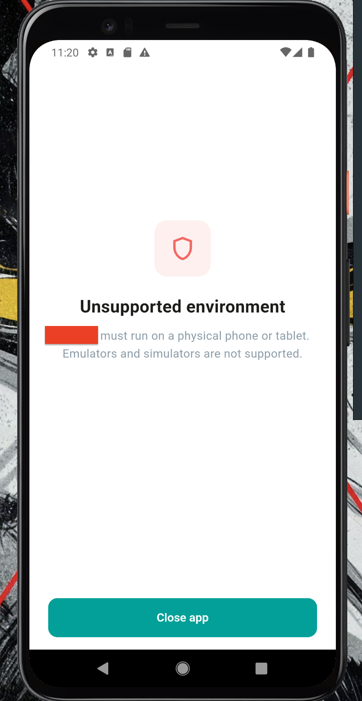
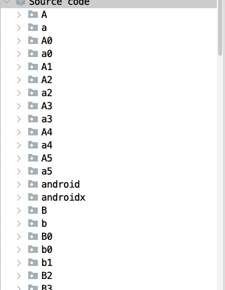
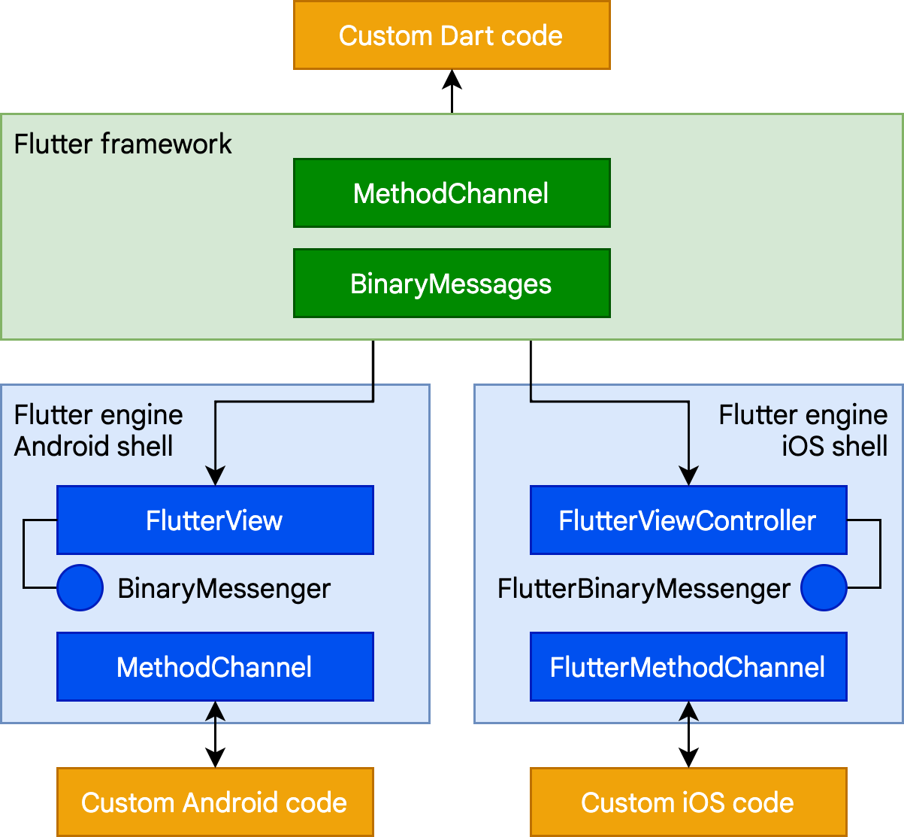
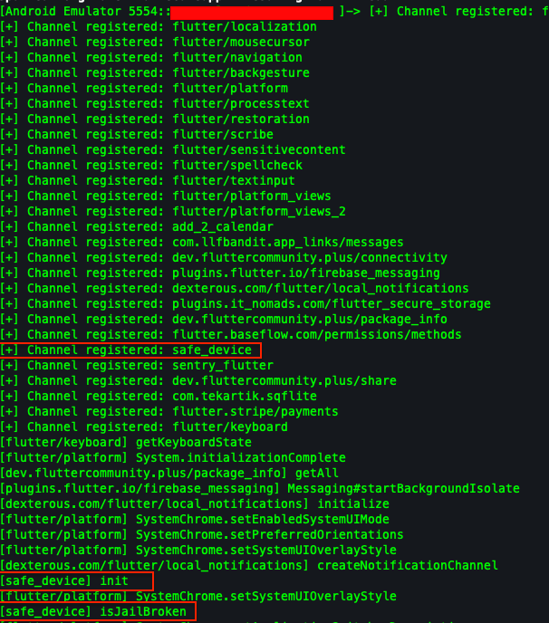
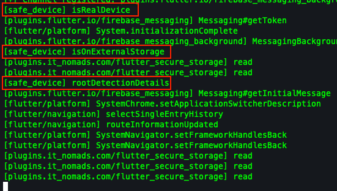
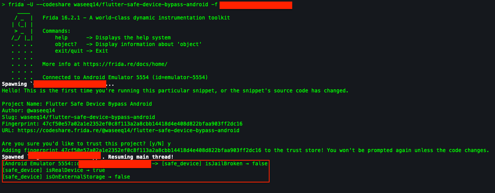
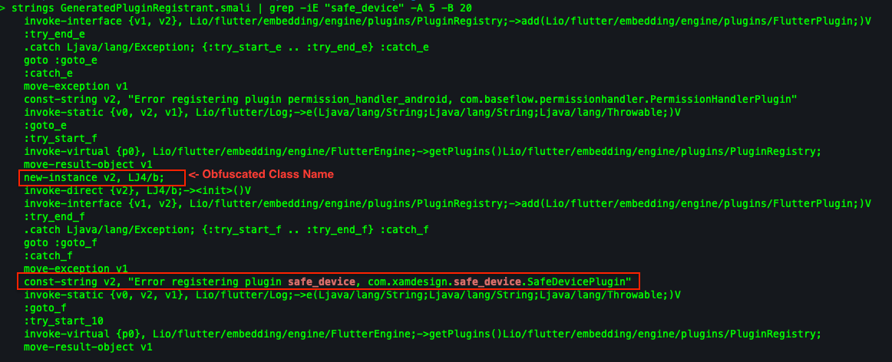
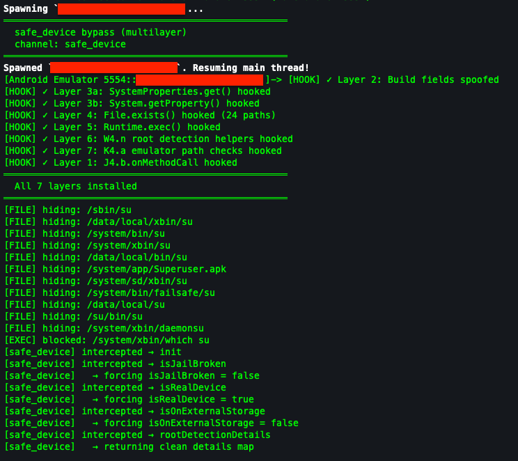

---

title: "Bypassing Flutter's safe_device Plugin"
date: 2026-10-12
draft: false

categories: ["Android"]
tags: ["flutter", "safedevice", "safe_device"]

description: "The first publicly documented Frida script to bypass the safe_device Flutter plugin's root and emulator detection, using MethodChannel interception and a 7-layer hooking strategy."
showToc: true
---

## Introduction

While pentesting a Flutter-based Android application, I hit a fullscreen block that wouldn't let the app run on my emulator:



On top of that, the binary was obfuscated. Original class names had been replaced with short, meaningless identifiers by R8:



So I needed to figure out which library was behind this block. The screen was clearly a Flutter-rendered widget (custom styling, app branding, teal button, not a native Android dialog), which told me the detection result was crossing from native Java code into Dart via a MethodChannel.

Looking through the AndroidManifest, I found a reference to `com.xamdesign.safe_device`. The [safe_device docs](https://pub.dev/packages/safe_device) describe a Flutter plugin for root, jailbreak, emulator, and mock location detection. I was surprised to find that no public Frida bypass exists for it, so I decided to write one.

This post walks through the full process: identifying the plugin in an obfuscated APK, understanding how Flutter plugins communicate internally, and then writing two different bypass scripts. One is a universal approach that works on any build without reverse engineering, and the other is a deep 7-layer hook that neutralizes every detection method from the inside (overkill? maybe. fun? absolutely).

---

## Understanding Flutter's Plugin Architecture

Flutter apps are split across two layers:

- **Dart side** (`libapp.so`): all the UI and business logic, compiled to native ARM code
- **Native side** (DEX files): Java/Kotlin code that handles platform-specific operations

These two layers are completely isolated from each other. Just like React Native apps communicate with the native layer through a bridge, Flutter apps use `BinaryMessenger` and `MethodChannel`.



`BinaryMessenger` is the low-level transport. It sends raw bytes between Dart and native code, like a raw TCP socket. `MethodChannel` is built on top of it and adds structure to those raw bytes. Think of it as HTTP built on top of TCP.

Each plugin registers its own named channel, and all communication flows through it. So the plan was to hook at the `MethodChannel` level, because that's where the method name (`"isRealDevice"`) and return value (`true`/`false`) are accessible as structured data. At the `BinaryMessenger` level it's just raw bytes.

Here's the important part: **Dart blindly trusts whatever the native side returns.** If we intercept the response and force `isRealDevice` to return `true`, Dart never knows the difference. The real detection result gets discarded before it ever reaches the UI.

---

## Analyzing the Calls

Before writing a bypass, I wanted to see exactly what methods the plugin calls and in what order. I wrote a recon script that hooks `MethodChannel.setMethodCallHandler` to intercept every channel registration and log every method call at runtime. You can grab it from [Frida CodeShare](https://codeshare.frida.re/@waseeq14/flutter-methodchannel-recon/).

```bash
frida -U --codeshare waseeq14/flutter-methodchannel-recon -f <package_name>
```

The output revealed the app's full startup sequence:




Now I could see the exact detection flow:
1. `[safe_device] init` configures detection settings
2. `[safe_device] isJailBroken` checks for root
3. `[secure_storage] read` reads cached tokens
4. `[safe_device] isRealDevice` checks for emulator
5. `[safe_device] isOnExternalStorage` checks storage location
6. `[safe_device] rootDetectionDetails` runs detailed root analysis

If any check fails, the app shows the block screen before stored tokens are ever used. And all five `safe_device` calls go through the same named channel, so one hook catches them all.

---

## Approach 1: Universal MethodChannel Bypass

Instead of hooking the obfuscated plugin class directly, this approach wraps the MethodChannel handler itself. It filters by channel name and method name, both of which are runtime strings that R8 can never rename:

```javascript
Java.perform(function() {
    var MethodChannel = Java.use("io.flutter.plugin.common.MethodChannel");
    var original = MethodChannel.setMethodCallHandler;
    
    original.implementation = function(handler) {
        var channelName = this.name.value;
        
        if (handler === null) { original.call(this, null); return; }
        
        var retained = Java.retain(handler);
        var Boolean = Java.use("java.lang.Boolean");
        
        var MethodCallHandler = Java.use(
            "io.flutter.plugin.common.MethodChannel$MethodCallHandler"
        );
        var wrapper = Java.registerClass({
            name: "Hook_" + channelName.replace(/[^a-zA-Z0-9]/g, "_"),
            implements: [MethodCallHandler],
            methods: {
                onMethodCall: function(call, result) {
                    if (channelName === "safe_device") {
                        var method = call.method.value;
                        var forced = {
                            "isRealDevice": true,
                            "isJailBroken": false,
                            "isJailBrokenCustom": false,
                            "isSafeDevice": true,
                            "isMockLocation": false,
                            "canMockLocation": false,
                            "isOnExternalStorage": false,
                            "isDevelopmentModeEnable": false,
                            "usbDebuggingCheck": false,
                        };
                        if (forced.hasOwnProperty(method)) {
                            console.log("[safe_device] " + method + " → " + forced[method]);
                            result.success(Boolean.valueOf(forced[method]));
                            return;
                        }
                    }
                    retained.onMethodCall(call, result);
                }
            }
        });
        
        original.call(this, wrapper.$new());
    };
});
```

Why does this work across any build? Because the obfuscated class name (`K4.b`, `J4.b`, or whatever R8 decides next) is never referenced. The script only cares about `"safe_device"` (channel name) and `"isRealDevice"` (method name). These are plain text strings that survive any obfuscation.

When a `safe_device` method is intercepted, the forced value is returned directly via `result.success()` and the real detection code never runs. Everything else passes through to the original handlers untouched.

Available on [Frida CodeShare](https://codeshare.frida.re/@waseeq14/flutter-safe-device-bypass-android).

```bash
frida -U --codeshare waseeq14/flutter-safe-device-bypass-android -f <package_name>
```



---

## Approach 2: Multilayer Deep Bypass

Before the universal approach came to mind, this was actually my original approach. I wanted to find the detection classes in the obfuscated binary and hook them directly :p

I'm including this in the blog because along the way I stumbled on a really interesting technique for getting around R8 class name obfuscation, without having to grep through thousands of files.

The multilayer approach goes deeper than just blocking at the door. It neutralizes every function behind the door too, so even if the MethodChannel hook misses (timing issues, race conditions), every underlying detection method still returns safe values.

### Mapping the Obfuscated Plugin Class

While reversing the decompiled APK, I came across a file called `GeneratedPluginRegistrant.smali`. Turns out it's an auto-generated file that Flutter creates to register all native plugins at startup. Since it's part of Flutter's engine infrastructure, R8 doesn't touch it.

But here's the interesting part: each plugin registration wraps the instantiation in a try/catch, and the catch block contains the **original class name** in the error string. So we get a direct mapping from obfuscated names back to the originals, for free.

It lives at a predictable path in every Flutter APK:

```
smali/io/flutter/plugins/GeneratedPluginRegistrant.smali
```

R8 renamed `SafeDevicePlugin` to `J4.b`, but it can't touch hardcoded string literals. The try/catch pair just hands us the mapping.



### Tracing the Call Graph

With `J4.b` identified, I opened it in JADX and read the `onMethodCall` handler. From there I traced every `invoke-static` call to map out the helper classes:

```
J4.b.onMethodCall("isJailBroken")
  └── W4.n.k0(context)          ← isRooted (main check)
        ├── W4.n.h0()            ← isDevelopmentEnv
        ├── W4.n.b0()            ← obviousRootSigns
        ├── W4.n.o()             ← suBinaryFound
        ├── W4.n.l(boolean)      ← dangerousProps
        ├── W4.n.x0()            ← rootBeerCheck
        ├── W4.n.m()             ← emulatorSpecificRoot
        └── W4.n.Y(String)       ← getSystemProperty

J4.b.onMethodCall("isRealDevice")
  └── K4.a.a(ArrayList)          ← emulator file paths
        └── K4.a.b()             ← secondary heuristic
```

### The 7 Layers

With the full call graph mapped, the script hooks at every level:

**Layer 1: MethodChannel interception** (`J4.b.onMethodCall`). Forces all method results to safe values before any detection code runs.

```javascript
var SafeDevicePlugin = Java.use("J4.b");
SafeDevicePlugin.onMethodCall.implementation = function (call, result) {
    var method = call.method.value;
    var forced = {
        "isJailBroken": false, "isRealDevice": true,
        "isSafeDevice": true, "isMockLocation": false,
        "isOnExternalStorage": false, "isDevelopmentModeEnable": false,
    };
    if (forced.hasOwnProperty(method)) {
        result.success(Java.use("java.lang.Boolean").valueOf(forced[method]));
        return;
    }
    this.onMethodCall(call, result);
};
```

**Layer 2: Build field spoofing.** The `isRealDevice` check reads `Build.*` fields as static field accesses, not method calls. Hooking methods alone won't catch these, so the fields need to be overwritten directly:

```javascript
var Build = Java.use("android.os.Build");
Build.FINGERPRINT.value = "samsung/o1sxeea/o1s:13/TP1A.220624.014/G991BXXS7EWBA:user/release-keys";
Build.MODEL.value       = "SM-G991B";
Build.MANUFACTURER.value = "samsung";
Build.BRAND.value       = "samsung";
Build.DEVICE.value      = "o1s";
Build.PRODUCT.value     = "o1sxeea";
Build.HARDWARE.value    = "exynos2100";
Build.BOARD.value       = "exynos2100";
Build.HOST.value        = "21DHA724";
Build.TAGS.value        = "release-keys";
Build.TYPE.value        = "user";
```

**Layer 3: SystemProperties spoofing.** Intercepts `android.os.SystemProperties.get("ro.kernel.qemu")` and `System.getProperty("os.arch")` to return clean values.

**Layer 4: File.exists() blocklist.** Returns `false` for 24 indicator paths (`/sbin/su`, `/dev/qemu_pipe`, `/system/app/Superuser.apk`, etc.). One hook neutralizes all file-based detection across the board.

**Layer 5: Runtime.exec() interception.** Blocks `which su`, `type su`, and `su --version` by replacing them with `echo`.

**Layer 6: Direct detection method hooks.** Forces every root detection helper to return `false`:

```javascript
var RootDetection = Java.use("W4.n");
RootDetection.k0.implementation = function (ctx) { return false; };  // isRooted
RootDetection.h0.implementation = function () { return false; };     // isDevelopmentEnv
RootDetection.b0.implementation = function () { return false; };     // obviousRootSigns
RootDetection.o.implementation = function () { return false; };      // suBinaryFound
RootDetection.l.overload("boolean").implementation = function () { return false; }; // dangerousProps
RootDetection.x0.implementation = function () { return false; };     // rootBeerCheck
RootDetection.m.implementation = function () { return false; };      // emulatorSpecificRoot
```

**Layer 7: Emulator path checker** (`K4.a`). Forces the emulator file-path list checker to always return `false`:

```javascript
var PathChecker = Java.use("K4.a");
PathChecker.a.overload("java.util.ArrayList").implementation = function (list) {
    return false;
};
PathChecker.b.implementation = function () {
    return true; // pretend OEM build
};
```

The detection code still runs, but every function it calls has been neutralized.



Available on [Frida CodeShare](https://codeshare.frida.re/@waseeq14/flutter-safe-device-bypass-multilayer).

---

## Surviving Build Updates

When the client released a new build, the multilayer script broke. R8 had renamed `K4.b` to `J4.b`. The fix took about 5 minutes:

1. Read `GeneratedPluginRegistrant.smali`, found `safe_device` now maps to `J4.b`
2. Opened `J4/b.smali`, traced the `invoke-static` calls to find new helper class names
3. Updated the references in the script

| Component | Old Build | New Build |
|-----------|-----------|----------|
| Plugin class | `K4.b` | `J4.b` |
| Root detection | `A2.a` | `W4.n` |
| Path checker | `LL4.a` | `K4.a` |

The channel name (`"safe_device"`) and method names (`"isRealDevice"`, `"isJailBroken"`) stayed exactly the same, because they're runtime strings that R8 can't touch. The universal approach (Approach 1) was completely unaffected by the update.

---

## Which Approach to Use?

**Use the universal bypass** when you just need to get past `safe_device` and move on. Works on any app, any build, no reverse engineering needed.

**Use the multilayer bypass** when you want to overkill like me lol. Or more practically, when the universal approach has timing issues (hook installs after the first check fires) and you need the extra layers as a safety net.

---

## Takeaways

These apply to bypassing any Flutter plugin, not just `safe_device`:

- **Start at the gate, work backwards.** Block screen → MethodChannel → plugin → detection logic.
- **Hook at the highest chokepoint.** The MethodChannel is the single pipe between native detection and Dart. One hook there replaces dozens of individual bypasses.
- **Use strings as anchors.** R8 renames classes, but runtime string literals survive. Channel names, method names, and error strings are stable targets across builds.
- **Layer for resilience.** Any single hook can fail. Multiple layers ensure coverage even when timing or obfuscation changes between builds.
- **GeneratedPluginRegistrant is the Rosetta Stone.** For any Flutter APK, this file maps obfuscated class names to original plugin names. Always at the same path, never obfuscated.

---

## Adapting for Your Target

**Universal bypass (Approach 1):** Works out of the box on any app using `safe_device`. No changes needed. The channel name and method names are the same across all apps. If you discover additional methods via the [recon script](https://codeshare.frida.re/@waseeq14/flutter-methodchannel-recon), just add them to the `forced` list.

**Multilayer bypass (Approach 2):** You'll need to update the obfuscated class names for your specific APK:

1. Find the plugin class:
```bash
grep "safe_device" smali/io/flutter/plugins/GeneratedPluginRegistrant.smali -B 5
# Look for: new-instance v2, L<CLASS>;  ← this is your plugin class
```

2. Find the helper classes:
```bash
grep -E "invoke-static" smali_classes2/<YOUR_CLASS>/b.smali | head -10
# The classes referenced here are your root detection and path checker classes
```

3. Find the helper method names:
```bash
# Open the root detection class in JADX and note the method signatures
# Or grep the smali for method definitions:
grep "\.method" smali_classes2/<ROOT_DETECTION_CLASS>/*.smali
```

4. Update the script with your class and method names.

---

## Scripts

All scripts are on Frida CodeShare:

- [flutter-methodchannel-recon](https://codeshare.frida.re/@waseeq14/flutter-methodchannel-recon) — logs all MethodChannel registrations and method calls
- [flutter-safe-device-bypass](https://codeshare.frida.re/@waseeq14/flutter-safe-device-bypass) — universal bypass (obfuscation-proof)
- [flutter-safe-device-bypass-multilayer](https://codeshare.frida.re/@waseeq14/flutter-safe-device-bypass-multilayer) — 7-layer deep bypass

---

